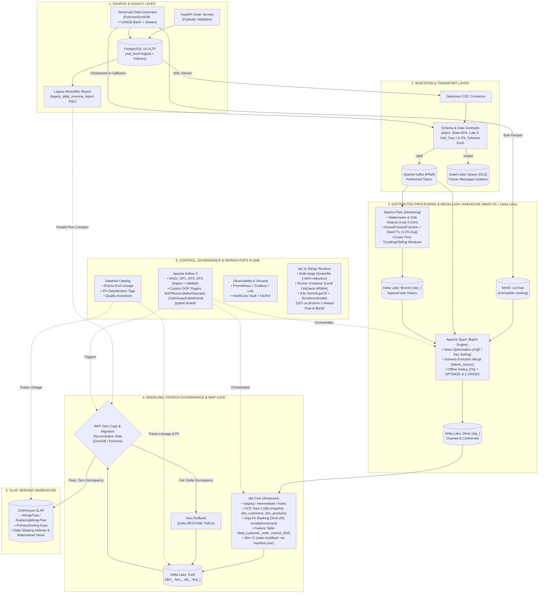

# Enterprise Commerce Data Platform

Production-shaped, end-to-end **Enterprise Data Engineering Platform** for e-commerce operations and real-time customer activity.

- **Scope:** 100% Data Platform Engineering (Ingestion, CDC, Streaming, Lakehouse, Warehouse, Orchestration, Governance, Observability, and Cloud IaC).
- **Scale Target:** `>= 100 GB` offline batch volume across core and extended commerce tables; `200–500 MB/s` sustained throughput (`0.5–1.0 GB/s` peak burst) with full Day-2 maintenance controls (compaction, state TTL, DLQ isolation, and backlog catch-up).
- **Canonical Docs:**
  - **Living Step-by-Step Build & Learning Guide:** [docs/runbooks/STEP_BY_STEP_BUILD_GUIDE.md](docs/runbooks/STEP_BY_STEP_BUILD_GUIDE.md)
  - Architecture & Design Decisions: [docs/architecture/PROJECT_SOLUTION.md](docs/architecture/PROJECT_SOLUTION.md)
  - Data Source & Simulation Strategy: [docs/research/DATA_SOURCE_AND_SIMULATION.md](docs/research/DATA_SOURCE_AND_SIMULATION.md)
  - 7-Stage Execution Checklist (100/100 DE Rubric): [docs/roadmap/IMPLEMENTATION_CHECKLIST.md](docs/roadmap/IMPLEMENTATION_CHECKLIST.md)

## End-to-End Architecture Flow



## 7-Stage Practical Roadmap

| Stage | Focus | Core Stack | DE Rubric Points |
| :--- | :--- | :--- | :--- |
| **Stage 1** | Container Foundation, Storage & Dockerfile Optimization | Docker Compose, PostgreSQL 16, MinIO, Multi-stage Dockerfile, Makefile | **5 pts** |
| **Stage 2** | Commerce Data Generator (`>=100 GB` + Stream) & CDC Ingestion | PyArrow/DuckDB Generator, FastAPI, Debezium CDC, Kafka KRaft, DLQ | **12 pts** |
| **Stage 3** | Real-Time Stream Processing | Apache Flink (Watermarks, Late Arrivals, State Dedup, Windowing) | **10 pts** |
| **Stage 4** | Batch Processing & Delta Lakehouse Optimization | Apache Spark (Skew, Schema Evolution, Dedup) + Delta Lake (`OPTIMIZE`, `Z-ORDER`) | **16 pts** |
| **Stage 5** | Dimensional Modeling, Slim CI & OLAP Serving Warehouse | dbt Core (`staging/intermediate/marts`, SCD Type 2, `state:modified+` Slim CI, PII Masking, `feat_` SQL table) + ClickHouse Indexing | **13 pts** |
| **Stage 6** | Orchestration, Custom Plugins & End-to-End Data Governance | Apache Airflow (DP1, DP2, DP3 + Custom OOP Operators/Hooks) + DataHub (Lineage, PII Classification & Assertions) | **24 pts** |
| **Stage 7** | Enterprise Ops, Migration Reconciliation, IaC & 2 Novel Ideas | WAP Zero-Copy & Legacy DW Reconciliation Gate, Prometheus/Grafana/Loki, Vault, NGINX, K3s GitOps (Helm/ArgoCD) & OCI Terraform/Ansible (`us-phoenix-1`) | **20 pts** |

## Quick Start (Stage 1)

```bash
make setup   # Create .env from .env.example if missing
make up      # Start PostgreSQL 16 + MinIO and auto-initialize lakehouse buckets
make ps      # Verify container health status
make test    # Run persistence and connectivity checks
```
