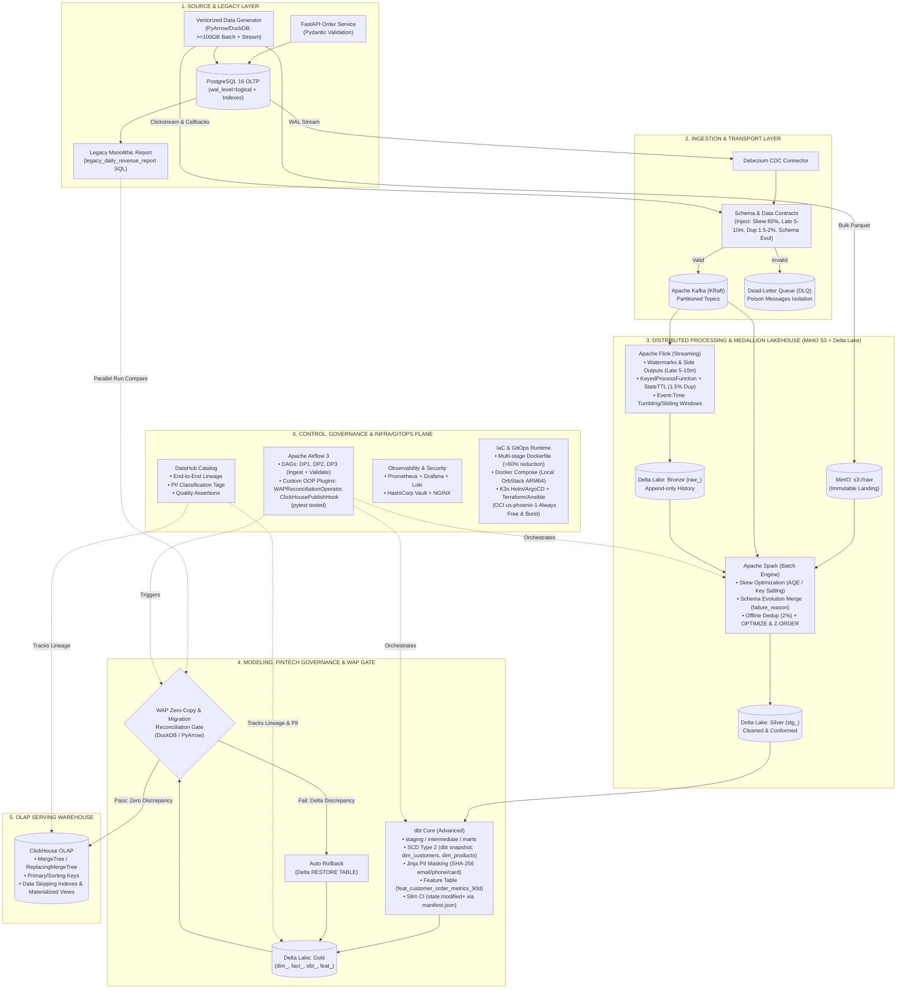

# MultiCloud-Commerce-Lakehouse: Real-Time & Batch Data Platform — From Local Dev to Oracle Cloud Production & Google Cloud Migration

> **Why This Architecture Exists (Real-World Banking, Fintech & Enterprise Context):**
> - **Why `Local Dev` $\rightarrow$ `Oracle Cloud Production`?** In traditional Banking, Fintech, and large-scale Enterprise retail, core transactional and data workloads heavily rely on **Oracle infrastructure** due to its strict network isolation, mission-critical stability, predictable I/O performance, security compliance, and enterprise support. However, operating these workloads as rigid monoliths creates massive technical debt. This project modernizes that foundation by building a 100% self-hosted, open-source **Medallion Lakehouse (`PostgreSQL 16 WAL`, `Debezium CDC`, `Kafka`, `Flink`, `Spark`, `Delta Lake + Apache Iceberg UniForm`, `dbt`, `ClickHouse`, `Airflow`, `DataHub`)** developed locally on `ARM64` and promoted via `Terraform` + `Ansible` + `K3s` to **Oracle Cloud Production**.
> - **Why `Oracle Cloud` $\rightarrow$ `Google Cloud Migration`?** As enterprises enter the **AI, Machine Learning, and Data Science era**, **Google Cloud (`GCP`)** stands out as the premier global platform for advanced analytics and AI/ML innovation. Yet in reality, banks and enterprises hesitate to migrate across clouds because moving heavy, messy data pipelines risks schema breakage, downtime, and financial discrepancy. By designing our platform to be **100% Cloud-Portable** from Day 1 (`Multi-stage Containers`, `K3s`, `Terraform`, `Delta/Iceberg UniForm`) and enforcing an automated **Write-Audit-Publish (WAP) Zero-Copy Reconciliation Gate (`Delta = 0`)**, this repository demonstrates how to execute a verifiable **Oracle Cloud $\rightarrow$ Google Cloud Migration** without losing a single transaction—laying a rock-solid data foundation for future AI/ML/DS initiatives on Google Cloud.

- **Scope:** 100% Pure Data Platform Engineering (Multi-Source Ingestion, Debezium CDC, Kafka, Flink Streaming, Spark Batch, Delta Lake + Apache Iceberg UniForm, dbt Dimensional Modeling, ClickHouse OLAP, Airflow 3, DataHub Governance, WAP Zero-Copy Reconciliation, and Multi-Cloud Terraform/Ansible/K3s IaC).
- **Scale Target:** `>= 100 GB` offline batch volume across 9 relational commerce tables; `200–500 MB/s` sustained throughput (`0.5–1.0 GB/s` peak burst) with full Day-2 maintenance controls (compaction, state TTL, DLQ isolation, and backlog catch-up).
- **3-Stage Infrastructure & Multi-Cloud Progression:**
  1. **From Local Dev (`macOS M1 Max / OrbStack Ubuntu 24.04 ARM64`):** High-speed daily development, unit/contract testing, production fault injection (Skew, Schema Evolution, Duplicates, Late Arrivals, Poison DLQ), and `>= 100 GB` batch verification (`3.9 GB/s` local NVMe).
  2. **To Oracle Cloud Production (`us-phoenix-1` — `$0` Always Free + Trial Burst):** Self-hosted `K3s` + `MinIO` + `PostgreSQL 16` + `Kafka` + `Flink` + `Spark` + `ClickHouse` + `Airflow` + `DataHub` on raw `ARM64` (`VM.Standard.A1.Flex`) & `AMD64` VMs with `10 TB/month` free egress.
  3. **& Google Cloud Migration (`Oracle Cloud` $\rightarrow$ `Google Cloud`):** Terraform-automated cross-cloud lakehouse migration drill replicating curated Gold & Feature-ready tables (`dim_`, `fact_`, `obt_`, `feat_`, `Delta/Iceberg UniForm`) from Oracle Cloud to Google Cloud, verified for zero financial discrepancy (`Delta = 0`) via the **WAP Zero-Copy Reconciliation Gate** to prepare for future AI/ML/DS workloads.
- **Canonical Docs:**
  - **Living Step-by-Step Build & Learning Guide:** [docs/runbooks/STEP_BY_STEP_BUILD_GUIDE.md](docs/runbooks/STEP_BY_STEP_BUILD_GUIDE.md)
  - **Vietnam DE Market Survey (2025–2026) & Architecture Alignment:** [docs/research/VIETNAM_DE_MARKET_AND_ARCHITECTURE_ALIGNMENT.md](docs/research/VIETNAM_DE_MARKET_AND_ARCHITECTURE_ALIGNMENT.md)
  - Architecture & Design Decisions: [docs/architecture/PROJECT_SOLUTION.md](docs/architecture/PROJECT_SOLUTION.md)
  - Data Source & Simulation Strategy: [docs/research/DATA_SOURCE_AND_SIMULATION.md](docs/research/DATA_SOURCE_AND_SIMULATION.md)
  - 7-Stage Execution Checklist (100/100 DE Rubric): [docs/roadmap/IMPLEMENTATION_CHECKLIST.md](docs/roadmap/IMPLEMENTATION_CHECKLIST.md)

## End-to-End Architecture Flow



## Enterprise Data Ecosystem (`Seed-and-Amplify` Unified Engine)

Rather than stitching disconnected public CSVs with mismatched foreign keys, the platform owns a vectorized generator (`commerce-datagen`) seeded with real commerce dictionaries (**Google `theLook` + Brazilian `Olist` Marketplace + `H&M` Product Catalog + `Open CDP` Behavioral Funnel**), producing **13 source tables/streams (165 columns)** with 100% referential integrity and feeding **14 curated Gold tables**:

- **3 Ingestion Channels:**
  1. **Transactional OLTP & CDC (`FastAPI` → `PostgreSQL 16 WAL` → `Debezium` → `Kafka`):** Live `INSERT/UPDATE` orders, payments, inventory mutations, and `dlq_poison_events` contract isolation.
  2. **High-Rate Behavioral & Webhook Stream (`Datagen` → `Kafka` → `Apache Flink`):** `clickstream` (injecting **5–10 min mobile late arrivals**) and `payment_callbacks` (injecting **`~1.5%` gateway duplicates**).
  3. **High-Throughput Historical Bulk (`PyArrow/DuckDB` → `MinIO s3://raw` + `Postgres COPY` → `Apache Spark`):** Generates `>= 100 GB` across 9 relational tables (`customers`, `distribution_centers`, `sellers`, `products`, `inventory_items`, `orders`, `order_items`, `payments`, `order_reviews`) with **80% Ho Chi Minh City / 75% Electronics Skew**, mid-dataset **`payments.failure_reason` Schema Evolution**, and **`~2%` `order_items` Offline Duplicates**.
- **14 Target Gold Tables (`dbt` + `Delta/Iceberg UniForm` + `ClickHouse`):**
  - **5 Dimensions (`dim_*`):** `dim_customers` (SCD Type 2 + `SHA-256` PII masking), `dim_products` (SCD Type 2), `dim_sellers`, `dim_distribution_centers`, `dim_date`.
  - **6 Facts (`fact_*`):** `fact_orders`, `fact_order_items`, `fact_payments`, `fact_inventory_movements`, `fact_clickstream_5m`, `fact_order_reviews`.
  - **1 One Big Table (`obt_*`):** `obt_commerce_sales_wide`.
  - **2 Feature & Label Tables:** `feat_customer_order_metrics_90d` (`event_timestamp`, `created_at`) and `label_customer_reorder_7d` (`will_order_in_7d`).
- **2-Phase Execution & Testing Strategy:**
  - **Phase A (Incremental Stage Build & Clean):** Test each newly built stage with lightweight `ci`/`dev` fixtures (`50 MB – 1 GB` in seconds), then wipe temporary volumes (`make clean`) to keep local SSD consumption at `0 GB` during development.
  - **Phase B (Full End-to-End Zero-to-Gold Campaign):** Once all 7 stages are wired together, trigger a clean-slate end-to-end run from `Source` → `CDC/Kafka` → `Flink/Spark` → `Bronze/Silver/Gold` → `WAP Gate` → `ClickHouse` → `Airflow/DataHub/Grafana`, measuring throughput (`MB/s`), latency (`ms`), and wall-clock execution time at every hop.

## 7-Stage Practical Roadmap

| Stage | Focus | Core Stack | DE Rubric Points |
| :--- | :--- | :--- | :--- |
| **Stage 1** | Container Foundation, Storage & Dockerfile Optimization | Docker Compose, PostgreSQL 16, MinIO, Multi-stage Dockerfile, Makefile | **5 pts** |
| **Stage 2** | Commerce Data Generator (`>=100 GB` + Stream) & CDC Ingestion | PyArrow/DuckDB Generator, FastAPI, Debezium CDC, Kafka KRaft, DLQ | **12 pts** |
| **Stage 3** | Real-Time Stream Processing | Apache Flink (Watermarks, Late Arrivals, State Dedup, Windowing) | **10 pts** |
| **Stage 4** | Batch Processing & Delta Lakehouse Optimization | Apache Spark (Skew, Schema Evolution, Dedup) + Delta Lake (`OPTIMIZE`, `Z-ORDER`) | **16 pts** |
| **Stage 5** | Dimensional Modeling, Slim CI & OLAP Serving Warehouse | dbt Core (`staging/intermediate/marts`, SCD Type 2, `state:modified+` Slim CI, PII Masking, `feat_` SQL table) + ClickHouse Indexing | **13 pts** |
| **Stage 6** | Orchestration, Custom Plugins & End-to-End Data Governance | Apache Airflow (DP1, DP2, DP3 + Custom OOP Operators/Hooks) + DataHub (Lineage, PII Classification & Assertions) | **24 pts** |
| **Stage 7** | Enterprise Ops, Migration Reconciliation, IaC & 2 Novel Ideas | WAP Zero-Copy & Legacy DW Reconciliation Gate, Prometheus/Grafana/Loki, Vault, NGINX, K3s GitOps (Helm/ArgoCD) & OCI Terraform/Ansible (`us-phoenix-1`) | **20 pts** |

## Quick Start (Stage 1)

```bash
make setup   # Create .env from .env.example if missing
make up      # Start PostgreSQL 16 + MinIO and auto-initialize lakehouse buckets
make ps      # Verify container health status
make test    # Run persistence and connectivity checks
```
