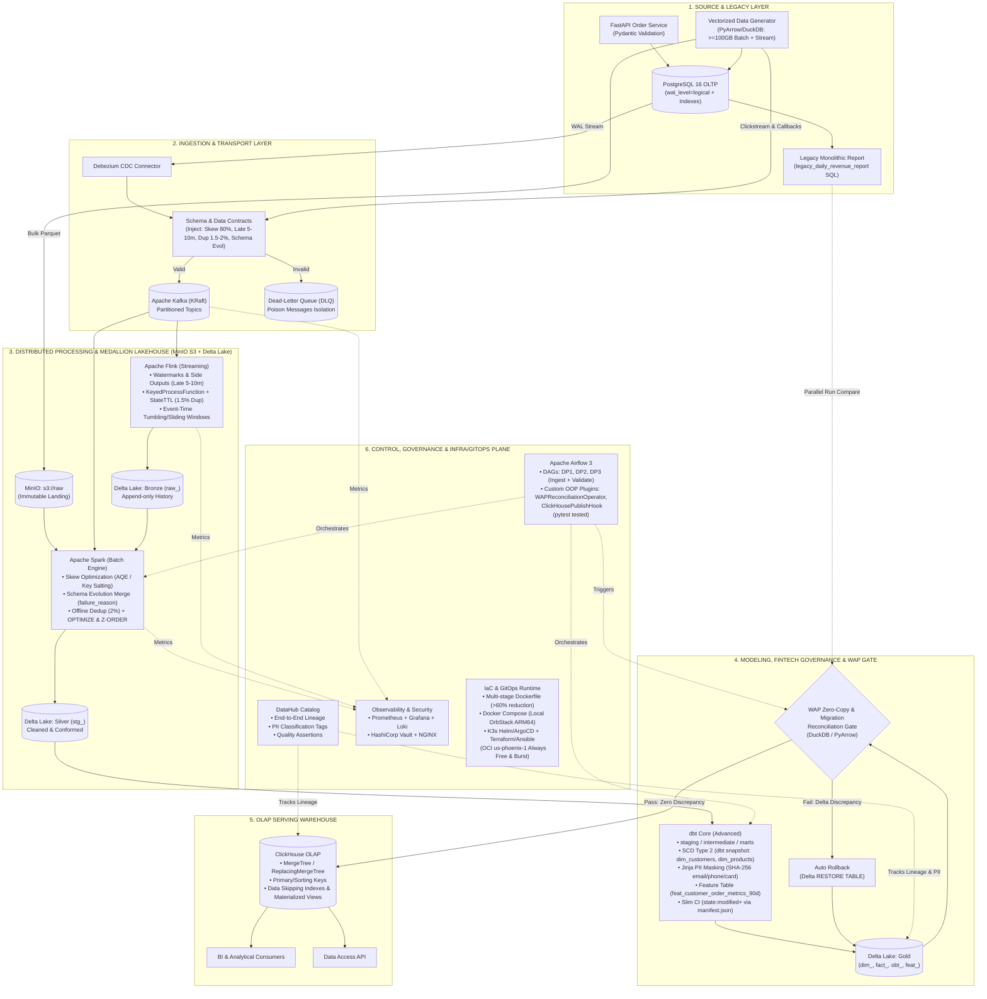

# MultiCloud-Commerce-Lakehouse: Real-Time & Batch Data Platform — From Local Dev to Oracle Cloud Production & Google Cloud Migration

**Status:** Accepted project direction  
**Scope:** 100% Pure Data Engineering & Multi-Cloud Lakehouse platform (`From Local Dev to Oracle Cloud Production & Google Cloud Migration`); ML and LLM are future downstream consumers  
**Primary domain:** E-Commerce operations, Fintech payment governance, and real-time customer activity  
**Decision owner:** Project owner  
**Change rule:** Update this document when an architectural decision changes. Do not maintain a competing architecture in another file.

## Table of contents

1. [Purpose](#purpose)
2. [Problem and outcomes](#problem-and-outcomes)
3. [Design principles](#design-principles)
4. [Target architecture](#target-architecture)
5. [Source ingestion](#source-ingestion)
6. [Storage and data products](#storage-and-data-products)
7. [Processing and orchestration](#processing-and-orchestration)
8. [Governance, quality, and observability](#governance-quality-and-observability)
9. [Infrastructure, Kubernetes, and Terraform](#infrastructure-kubernetes-and-terraform)
10. [Scale and capacity model](#scale-and-capacity-model)
11. [Production test strategy](#production-test-strategy)
12. [Delivery roadmap](#delivery-roadmap)
13. [Explicit non-goals](#explicit-non-goals)
14. [Future ML and LLM extensions](#future-ml-and-llm-extensions)
15. [Change log](#change-log)

## Purpose

This project is a real engineering exercise for an internal commerce data platform, not a toy benchmark. It should provide reliable, replayable, governed data products for analytics and operations while preserving clean extension points for feature engineering, ML, and LLM applications.

The platform is intentionally designed as a **single-region, single-domain, scale-out-ready reference implementation**. It will use a small local or remote topology while keeping the interfaces, data contracts, deployment boundaries, and operational practices needed for larger environments.

The project will not claim that a Mac or one VPS is processing production-scale terabytes. It will prove scale readiness through capacity models, controlled load profiles, replay tests, and measured bottlenecks.

## Problem and outcomes

The platform addresses a common enterprise problem: business data arrives from transactional databases, APIs, files, and event streams with different delivery guarantees and quality issues. Downstream analytics need consistent, timely, traceable data without repeatedly loading or damaging source systems.

The first product is a trusted commerce data foundation containing:

- Orders, order items, payments, customers, products, inventory, and delivery events.
- Near-real-time operational events such as clickstream and payment callbacks.
- Historical Bronze, Silver, and Gold datasets.
- Business-ready dimensional models and analytical marts.
- Replayable ingestion, idempotent processing, backfill, and data-quality gates.
- Catalog, ownership, lineage, freshness, and operational monitoring.

The project uses a three-source realism strategy. Public datasets and deterministic synthetic generators provide repeatable load and failure experiments. A permitted, anonymized company data extract may be used for batch schema, history, and backfill practice, but it must never leave an approved boundary or enter Git, images, logs, or public storage. A historical database is valuable even when it is not a stream: CDC, change replay, event-time simulation, and source adapters can turn controlled changes into streaming test input without pretending that the original database is an event platform.

## Design principles

1. **Use the smallest useful set of technologies.** One tool owns each responsibility. Do not add a second query engine, table format, quality framework, or deployment system without a measured need.
2. **Separate data, control, and infrastructure planes.** Pipelines move data; Airflow coordinates them; Terraform and Kubernetes provide runtime infrastructure.
3. **Object storage is the durable analytical source.** Kafka is a replay buffer and transport layer, not the long-term archive.
4. **Contracts precede processing.** Every source has a schema, compatibility policy, ownership, and failure path.
5. **Batch and streaming share a data model.** Flink handles event-time workloads; Spark handles batch, compaction, and backfill. They converge in the lakehouse.
6. **Make every operation replayable and idempotent.** Retries and reprocessing must not create incorrect business results.
7. **Measure before claiming scale.** Throughput, lag, freshness, recovery time, storage growth, and cost are recorded for every load profile.
8. **Build for learning without hiding the mechanics.** Local Compose makes process, network, storage, and failure behavior visible before Kubernetes abstracts them.
9. **Keep future consumers decoupled.** ML and LLM systems consume governed data products; they do not redefine the source pipeline.

## Target architecture



The main path uses one lakehouse table format. The coursework-aligned first implementation uses Delta Lake; the table access layer remains isolated so a future Iceberg or Hudi migration is possible without rewriting source adapters and business contracts. The main path must not run multiple table formats simultaneously.

### Storage, table format, and query engine are different layers

These technologies are complementary rather than interchangeable:

| Layer | Examples | Responsibility |
|---|---|---|
| Object storage | MinIO, Amazon S3, Google Cloud Storage | Stores objects and files such as JSON, Parquet, checkpoints, and metadata |
| Table format | Delta Lake, Apache Iceberg, Apache Hudi, Apache Paimon | Adds table metadata, transaction logs, schema evolution, snapshots, merges, and time travel on object storage |
| Compute engine | Apache Spark, Apache Flink | Performs batch, streaming, transformation, aggregation, and maintenance work |
| Query engine | Trino, Spark SQL, DuckDB, ClickHouse | Executes SQL or analytical queries against tables and other sources |
| Catalog and governance | DataHub, Hive Metastore, Nessie, Glue Catalog | Registers tables, schemas, locations, ownership, and lineage |

Trino is therefore not a lakehouse format. It is a distributed SQL query engine that can query lakehouse tables through connectors. Depending on connector and version, Trino can query Delta Lake, Iceberg, Hudi, Parquet, relational databases, and other systems. A Trino catalog points to a table format and its catalog or storage location.

Delta Lake, Iceberg, and Hudi occupy the same architectural layer and are alternatives for the main table path:

- **Delta Lake:** strong Spark integration and a good first choice for this Spark-first coursework project.
- **Apache Iceberg:** strong multi-engine and multi-cloud interoperability, partition evolution, and broad support across Spark, Flink, Trino, and cloud platforms.
- **Apache Hudi:** strong incremental processing, upserts, and CDC-oriented workloads; it was created at Uber and is used in public Grab data-platform designs.
- **Apache Paimon:** another streaming-oriented table format that can be considered later, but it is outside the first project path.

The project will use Delta Lake in the first implementation to align with the course. Iceberg and Hudi belong in isolated comparison experiments or a later migration ADR, never as simultaneous table formats in the same production path.

All three formats can use the same object-storage backends. For example, separate table prefixes in one MinIO bucket could look like:

```text
s3://lake/commerce_delta/orders/
├── data/*.parquet
└── _delta_log/*

s3://lake/commerce_iceberg/orders/
├── data/*.parquet
└── metadata/*.json

s3://lake/commerce_hudi/orders/
├── *.parquet
└── .hoodie/*
```

The storage backend is still MinIO. The format-specific files provide table semantics. A catalog such as a filesystem/path catalog, Hive Metastore, REST catalog, Nessie, or a cloud catalog registers the table for engines such as Spark, Flink, and Trino. These are separate choices: storage backend, table format, catalog, and compute/query engine should not be conflated.

#### Why Banking / BFSI in Vietnam prefers `Apache Iceberg + MinIO` vs `Delta Lake` — and how this project bridges both via `Delta UniForm`

In the 2025–2026 Vietnamese Banking & Financial Services (BFSI) market (Vietcombank, Techcombank, MB, VPBank, ACB, TPBank), Senior Data Engineer JDs heavily emphasize **`Apache Iceberg + MinIO`** alongside `Spark`, `Flink`, and `Trino/Dremio` for four concrete architectural and regulatory reasons:

| Dimension | Why Banking / On-Prem BFSI chooses `Apache Iceberg + MinIO` | Why `Delta Lake` is chosen for Spark/Databricks-first stacks |
|---|---|---|
| **1. Regulatory & Vendor Neutrality (SBV & Decree 13 / PDPD)** | Core banking, card, and credit data must reside on-premises (`MinIO` / Ceph S3). `Iceberg` (originated at Netflix/Apple, governed 100% by Apache) is strictly vendor-neutral with zero commercial cloud lock-in. | `Delta Lake` is tightly coupled with the Databricks ecosystem; on-premise banks avoid tying long-term storage governance to a single commercial cloud vendor. |
| **2. Multi-Engine First-Class Support (`Spark` + `Flink` + `Trino/Dremio`)** | Banks migrating off legacy Cloudera (Hadoop/Hive) rely on `Trino` or `Dremio` for federated BI SQL and `Flink` for real-time fraud streaming, where `Iceberg` ACID reads/writes (`MERGE`, `DELETE`) are first-class. | `Delta Lake` is deepest and fastest inside `Apache Spark`, whereas non-Spark engines historically treated `Iceberg` as their primary open table target. |
| **3. `Partition Evolution` & `Hidden Partitioning`** | Multi-year banking transaction tables (`10+ years`, tens of TBs) can evolve partitioning (e.g., from `month(txn_ts)` to `day(txn_ts)`) solely in metadata **without rewriting historical Parquet files** or changing SQL queries. | Changing physical partition keys in traditional `Delta Lake` or Hive tables requires rewriting existing historical data files. |
| **4. Centralized Catalog Security (`REST Catalog / Nessie / Ranger`)** | `Iceberg` enforces all commits through a catalog pointer (`metadata.json -> Manifest List -> Manifest File`), integrating cleanly with **Apache Ranger / OPA** for row/column-level banking security and Git-like branching (`Nessie`). | Standalone `Delta Lake` tracks state directly in `_delta_log/*.json` on the filesystem unless paired with Unity Catalog. |

**Architectural Bridge (`Delta UniForm` — One Storage Copy, Dual Protocol Compatibility):**
Because both `Delta Lake` and `Apache Iceberg` write immutable `ZSTD`-compressed **Apache Parquet** data files on `MinIO` and differ only in their JSON/Avro metadata envelopes, this platform satisfies **100% of the coursework `Delta Lake` rubric** while simultaneously supporting **Banking `Apache Iceberg` compatibility** by enabling **Delta Universal Format (`UniForm`)** on curated tables in Stage 4:

```sql
ALTER TABLE silver.stg_orders SET TBLPROPERTIES (
  'delta.universalFormat.enabledFormats' = 'iceberg'
);
```

Whenever Spark commits a transaction to `_delta_log/`, `UniForm` asynchronously generates the corresponding `metadata/*.json` and manifest tree for `Apache Iceberg` in the same `MinIO` table directory (`0%` duplicate Parquet data cost, `100%` interoperability with both Spark/Delta and Trino/Iceberg banking architectures).

### What MinIO provides and does not provide

MinIO provides the object-storage layer: S3-compatible APIs, buckets, object reads and writes, policies, versioning, lifecycle controls, encryption options, notifications, and distributed storage features when deployed with the required nodes and disks. Its S3-compatible interface is useful because the same application and table paths can later move to Amazon S3 or Google Cloud Storage with limited changes.

MinIO does not provide table transactions, SQL, Spark or Flink processing, orchestration, data contracts, data quality, catalog lineage, or business semantics. Those capabilities come from Delta Lake, Iceberg or Hudi; Spark and Flink; Airflow; contracts and tests; DataHub; and serving engines such as ClickHouse or Trino.

A single MinIO container on a laptop is a development object store. A production object store requires an appropriate distributed deployment, disks, network, replication or erasure coding, backup, lifecycle policy, monitoring, and recovery tests. MinIO is a strong storage foundation, not the entire Data Platform.

### Trino and ClickHouse

Trino and ClickHouse sit near the same analytics-serving layer, but they solve different problems:

| System | Type | Best fit |
|---|---|---|
| Trino | Distributed federated SQL query engine | Querying Delta/Iceberg/Hudi, object storage, and multiple databases without copying every dataset into one store |
| ClickHouse | Columnar analytical database | Low-latency, high-concurrency analytics on curated data that has been loaded or materialized into ClickHouse |

Trino is primarily a compute and query layer; it does not own the canonical data. ClickHouse is a serving database with its own storage, ingestion, indexes, partitions, and materialized views. They can coexist, with Trino used for lakehouse exploration and federation and ClickHouse used for hot business dashboards or APIs.

The lean first path uses one primary serving engine. ClickHouse is preferred when the project needs a fast analytical serving surface. Trino is added later when federated SQL or direct lakehouse querying is a demonstrated requirement. The project must not deploy both merely because both are available.

## Source ingestion

### Source realism and controlled data use

The platform must practice three different properties rather than search for one magical dataset:

| Property | Suitable source | What it proves |
|---|---|---|
| Real business shape | Authorized company snapshot, theLook-shaped Postgres, or Olist | Messy schemas, keys, nulls, corrections, SCD, payments, delivery, and domain rules |
| Reproducible scale | Seeded synthetic generator and deterministic Parquet/event writer | Exact volume, skew, event size, burst rate, late data, poison records, and repeatable benchmarks |
| Streaming behavior | PostgreSQL CDC, outbox/change-log replay, API polling simulator, and event producer | Ordering, offsets, partitions, retries, consumer lag, replay, checkpointing, and event-time behavior |

The company database may contain valuable 30-year history for batch profiling, schema evolution, SCD/backfill, reconciliation, and performance tests. It does not become a stream merely because it is large. Use only data that the owner has explicitly authorized, remove or tokenize personal and confidential fields, keep it in an isolated local environment, document retention, and never upload it to a public repository or unapproved cloud. Create a sanitized snapshot and a reproducible change-log/replay harness instead of connecting the platform directly to a production database.

The project will maintain a small public or synthetic reference dataset for CI and a separate local-only dataset profile for larger experiments. A replayable change log generated from the historical snapshot will exercise Kafka and Flink; the original database remains an OLTP/batch source.

### How large volume is practiced without storing petabytes

Company history and public datasets prove realism of shape. They rarely prove daily ingest rate. Thirty years of records in an OLTP database is accumulated state, not a PB/day stream. A 10 TB historical snapshot averaged over 30 years is roughly 1 GB/day of historical accumulation. PB/day is an ingress rate of about 11.6 GB/s, which is a different problem.

The project therefore practices volume in three complementary ways:

1. **Shape from real data.** An authorized, anonymized company snapshot, a theLook-shaped Postgres seed, or Olist supplies schemas, keys, nulls, corrections, SCD cases, and business rules. NYC Taxi is not a shape source for Gold; it is an isolated file fixture.
2. **Rate from a generator.** A seeded producer emits events that match those contracts at a controlled events/sec and bytes/sec. The generator can clone, mutate, skew, delay, duplicate, and poison records without requiring a source that already produces PB/day.
3. **Scale from measurement plus a model.** The lab measures the maximum sustainable rate of one partition, one broker, one Spark/Flink worker, and one object-store prefix. The architecture model multiplies those measured units to 10 TB/day, 100 TB/day, and PB/day.

A PB/day campaign must not try to persist 1 PB locally. Use these lab methods instead:

| Method | What is stored | What is proven |
|---|---|---|
| Stats-only load | Counters, lag, CPU, disk, network | Maximum ingest or processing rate |
| Short burst | Minutes of data, then delete | Peak multiplier and backpressure |
| Time compression | One day of history replayed in one hour | Event-time, watermarks, late data, and window correctness under accelerated clocks |
| Partition saturation | Data for one or a few partitions | Per-partition throughput, hot keys, and consumer lag |
| Schema-faithful fan-out | Sampled real records cloned with new IDs | Volume using real field distributions |
| Component isolation | One layer at a time | Kafka, object storage, Spark, Flink, and serving bottlenecks separately |
| Full path at small/medium | End-to-end Bronze to Gold | Correctness, idempotency, quality gates, and recovery |

The generator must be contract-driven. It reads the same event schema used by CDC and API adapters and can mix:

- Replayed company-derived change logs.
- Public dataset rows mapped to commerce events.
- Synthetic records with controlled size, skew, late arrival, duplicates, and invalid payloads.

Every scale report must state whether the run persisted data, sampled data, or discarded payloads after measurement. A PB/day number without event size, peak multiplier, replication, partition count, and the measured unit it was calibrated from is not an architecture claim.

### Data source catalog

The project uses one commerce domain and several source *types*. It does not mix taxi, reviews, ads, and retail into one canonical Gold model. Public datasets are adapters into that domain or isolated scale fixtures. Evidence, sizes, licenses, and rejected corpora are recorded in [DATA_SOURCE_AND_SIMULATION.md](../research/DATA_SOURCE_AND_SIMULATION.md).

Shape sources are an authorized company snapshot, theLook-shaped Postgres, and Olist. NYC Taxi is an isolated file fixture, not a shape source for Gold.

#### Canonical OLTP and CDC source

The primary source system is a PostgreSQL commerce schema aligned with theLook eCommerce: `users`, `products`, `orders`, `order_items`, `inventory_items`, `events`, `distribution_centers`, plus payments if required by the product. theLook is a Looker/Google synthetic clothing store published as `bigquery-public-data.thelook_ecommerce`. Typical analyses sit around 100k users/orders; public extracts are on the order of 170 MB. That is enough for schema practice and far too small as a lakehouse volume source.

The operational pattern is:

```text
Seed snapshot
  → PostgreSQL
  → owned contract-driven generator writes inserts/updates/deletes
  → Debezium reads WAL
  → Kafka topics per table
```

This is the main source path. Factor House's theLook eComm CDC/datagen is a pattern and reference for live OLTP activity (purchases, updates, cancellations, returns, ghost sessions, configurable QPS). It is not a runtime dependency. Own the generator in this repository.

An authorized company snapshot later maps onto the same contracts: different rows, same tables, same ingestion rules.

#### Additional source types in the same domain

| Type | Concrete source | Role |
|---|---|---|
| OLTP CDC | PostgreSQL + theLook-shaped in-repo generator | Orders, customers, products, inventory, payments |
| Clickstream/events | `events` table plus a web/mobile producer | Page view, cart, purchase callbacks |
| REST/SaaS API | FastAPI order/catalog service in front of PostgreSQL | Pagination, rate limits, tokens, partial responses |
| Files | Daily CSV/Parquet dumps and SFTP-style arrivals | Manifests, checksums, late/corrupt/duplicate files |
| Messy commerce adapter | Olist (99,441 orders, 9 CSVs, ~45 MB compressed / 120–130 MB raw) | Multi-item orders, split sellers, installments, delivery SLA, reviews, geo, SCD/backfill. Not a second Gold domain |
| Optional company snapshot | Authorized anonymized extract only | Real nulls, corrections, long history, SCD/backfill |

Company data is an optional adapter behind the same contracts. It is never the only source, never committed to Git, and never connected live to production. History is state; a changelog replay is the stream.

#### Public bulk fixtures for lake and serving scale

These datasets are too useful to ignore, but they are *fixtures*, not a second business domain and not Gold:

| Dataset | Typical size | Best isolated use |
|---|---|---|
| Open CDP / REES46 store events | ~206k users, ~412M events, ~52 GB uncompressed; Kaggle ~4.6 GB compressed | Clickstream volume, sessionization, late events |
| NYC TLC trip Parquet | Monthly vendor files with schema drift. Official 2024 yellow: 41,169,638 trips | Spark/Delta file ingestion, partitioning, compaction. Taxi, not commerce |
| Amazon Reviews 2023 | 571.54M reviews, 54.51M users, 48.19M items; hundreds of GB on disk | Nested documents, schema evolution, file/API-style landing |
| GA4 obfuscated merchandise events | Small BigQuery public sample | Event schema practice, not volume |
| TPC-DS via `dsdgen` | SF1 ≈ 1 GB, SF100 ≈ 100 GB, SF1000 ≈ 1 TB, SF10000 ≈ 10 TB | ClickHouse/dbt warehouse performance, skew, star/snowflake queries |
| ClickHouse serving labs | ClickBench ~100M hits; GitHub events 3.1B / 75 GB download | Serving-engine stress only |

NYC Taxi remains the best public *file* corpus because monthly Parquet files actually drift. TPC-DS remains the best *generated warehouse* corpus because scale factor is a knob. Open CDP is the best public commerce-like clickstream volume. None of them replace the theLook-shaped OLTP/CDC path.

#### Simulation stack

Do not make the platform depend on a random GitHub generator. Own a small in-repo generator with the same contracts as production adapters. External tools are references and optional load harnesses:

| Tool | Use |
|---|---|
| In-repo commerce generator | Canonical. Seeded, contract-driven, writes PostgreSQL and/or Kafka, can clone/skew/delay/duplicate/poison |
| Factor House theLook simulator | Pattern/reference only for live OLTP activity that Debezium can capture. Not a runtime dependency |
| Materialize `datagen` | Schema-driven fake data with joinable keys |
| AWS Flink DataGen example | High-rate parallel generation; published ~64k records/sec per small cluster |
| `kafka-data-gen` / Khaos-style harness | Events/sec, message size, hot partitions, consumer lag, broker failure |
| `dsdgen` | Warehouse-scale analytical tables |

The generator has profiles:

```text
ci             small, deterministic, checked into tests (~50–100 MB)
dev            interactive daily coding profile (~1–2 GB, <10s runtime, <8 GB total disk across zones)
rubric_100gb   >=100 GB chunked Parquet generation (250–500 MB chunks, <6 GiB RAM) with rolling stage cleanup
stream         CDC or direct Kafka at a target events/sec with late arrivals, duplicates, and drift
stress         stats-only or short-burst (--max-seconds 10 --max-gb 2 hard caps); 0 GB permanent disk footprint
```

#### Unified Single-Source Engine (Seed-and-Amplify across DE, ML, and LLM/RAG)

Rather than stitching disconnected datasets across modules, the canonical implementation uses **one unified in-repo data engine (`commerce-datagen`)** that satisfies all three coursework layers (Data Platform, ML Platform, and LLM/Agent Platform) and scores the full **18/100 Rubric points** dedicated to `Implement Data Generator` (12 pts) and `Improve the Data Generator` (6 pts):

1. **Real Catalog & Policy Seed (`~10–50 MB`):** Seeds `products` from real e-commerce catalog descriptions (`theLook` / `H&M articles.csv` `detail_desc`) paired with structured Markdown `FAQ & Shipping/Return Policy` documents. This ensures `product_id`, `customer_id`, and `order_id` link seamlessly across OLTP tables, Feast offline/online features, and the Module 2 RAG vector store without generating meaningless random strings.
2. **Vectorized Bulk Amplification (`PyArrow` / `DuckDB` / `PySpark`):** Generates the full **9-table OLTP & Marketplace relational graph (`123 columns`)** plus **4 Streaming, Webhook, DLQ & Legacy DW feeds (`42 columns`)** and daily `label` snapshots (`will_order_in_7d`) in `250–500 MB` streaming chunks so the Apple M1 Max (`10 cores, 64 GiB RAM, 214 GiB available SSD`) writes `>= 100 GB` in 3–6 minutes using `< 6 GiB RAM`.
3. **Config-Driven Rubric Problem Injection (`generator_config.yaml`):**
   - **Data Skew (Offline):** `80%` of `orders.shipping_city = 'Ho Chi Minh City'`; `75%` of `products.category = 'electronics'`.
   - **Schema Evolution (Offline):** Mid-dataset offset adds nullable string column `failure_reason` to `payments`.
   - **Offline Duplicates:** `~2%` of `order_items` duplicated with shifted `created_ts`.
   - **SCD Type 2 History:** Controlled price/status/segment mutations producing `valid_from_ts`, `valid_to_ts`, and `is_current`.
   - **Streaming Late Arrivals & Duplicates:** `clickstream` mobile events delayed 5–10 minutes; `~1.5%` of `payment_callbacks` duplicated; configurable **Data Drift** distribution shifts for ML retrain triggers.
4. **Rolling Stage Cleanup (Protecting the `214 GiB` Local SSD):** During the `rubric_100gb` campaign on the Mac, the pipeline executes stage-by-stage: generate `100 GB` Raw → run Spark DP1 (Raw → Bronze with `ZSTD` dictionary/RLE compression reducing high-skew data to `~25–35 GB`) → capture Spark UI/DataHub evidence and purge temporary `100 GB` Raw before running DP2/DP3 (Bronze → Silver → Gold → Feast). Peak local disk usage never exceeds `~130 GiB`.

#### Canonical Multi-Source Schema Catalog (13 Source Feeds / 150+ Columns → 14 Gold Tables)

Combining **Google `theLook` (OLTP & Logistics)**, **Brazilian `Olist` (Marketplace & SLA)**, **`H&M` (Rich Product Catalog)**, and **`Open CDP` (Behavioral Clickstream)**:

| # | Source Table / Stream | Cols | Key Columns & Grain | Rubric Problem / Enterprise Governance |
| :---: | :--- | :---: | :--- | :--- |
| **1** | `customers` *(OLTP/CDC + Parquet)* | 18 | `customer_id`, `email`, `phone`, `first_name`, `last_name`, `gender`, `birth_year`, `city`, `state`, `country`, `postal_code`, `latitude`, `longitude`, `traffic_source`, `segment`, `device_type`, `signup_ts`, `updated_ts` | **SCD Type 2 (`dbt snapshot`)** on `segment`/`city`/`email` + **PII `SHA-256` hashing** on `email`, `phone` |
| **2** | `distribution_centers` *(OLTP/CDC)* | 8 | `dc_id`, `dc_code`, `name`, `region`, `city`, `country`, `latitude`, `longitude` | Supply chain / warehouse fulfillment network (`theLook`) |
| **3** | `sellers` *(OLTP/CDC)* | 9 | `seller_id`, `seller_name`, `tax_code`, `city`, `state`, `seller_tier`, `rating_score`, `is_active`, `joined_ts` | Multi-merchant marketplace fulfillment (`Olist`) |
| **4** | `products` *(OLTP/CDC + Parquet)* | 17 | `product_id`, `sku`, `name`, `category`, `subcategory`, `department`, `garment_group`, `brand`, `seller_id`, `default_dc_id`, `cost_price`, `base_price`, `retail_price`, `weight_grams`, `detail_desc`, `is_active`, `created_ts`, `updated_ts` | **Skew #1 (`R6`):** `75%` `category = 'electronics'` + **SCD Type 2** price/status history + real `H&M`/`theLook` `detail_desc` |
| **5** | `inventory_items` *(OLTP/CDC + Parquet)* | 9 | `inventory_item_id`, `product_id`, `dc_id`, `batch_lot_no`, `unit_cost`, `stock_status`, `created_ts`, `sold_ts`, `updated_ts` | Stock tracking & COGS gross margin calculation |
| **6** | `orders` *(OLTP/CDC + Parquet)* | 20 | `order_id`, `customer_id`, `status`, `shipping_city`, `shipping_state`, `shipping_country`, `coupon_code`, `item_count`, `subtotal_amount`, `discount_amount`, `shipping_fee`, `tax_amount`, `total_amount`, `currency`, `order_ts`, `approved_ts`, `delivered_carrier_ts`, `delivered_customer_ts`, `estimated_delivery_ts`, `updated_ts` | **Skew #2 (`R6`):** `80%` `shipping_city = 'Ho Chi Minh City'` + delivery SLA tracking (`Olist`) |
| **7** | `order_items` *(OLTP/CDC + Parquet)* | 17 | `order_item_id`, `order_id`, `product_id`, `seller_id`, `inventory_item_id`, `dc_id`, `quantity`, `unit_price`, `cost_price`, `discount_amount`, `tax_amount`, `shipping_share_amount`, `net_line_amount`, `item_status`, `created_ts`, `shipped_ts`, `delivered_ts`, `returned_ts` | **Offline Duplicates (`R8`):** `~2%` duplicate `order_item_id` rows with shifted `created_ts` |
| **8** | `payments` *(OLTP/CDC + Parquet)* | 15 | `payment_id`, `order_id`, `customer_id`, `payment_sequential`, `method`, `provider`, `installments`, `amount`, `fee_amount`, `currency`, `card_last4`, `status`, `payment_ts`, `updated_ts`, **`failure_reason` *(nullable)*** | **Schema Evolution (`R7`):** Mid-dataset addition of 15th column `failure_reason` + **PII `SHA-256`** on `card_last4` |
| **9** | `order_reviews` *(OLTP/CDC + Parquet)* | 10 | `review_id`, `order_id`, `customer_id`, `product_id`, `rating_score`, `review_title`, `review_comment`, `sentiment_label`, `created_ts`, `answered_ts` | Post-purchase ratings & NLP/RAG review corpus |
| **10** | `clickstream` *(Kafka Topic)* | 14 | `event_id`, `session_id`, `customer_id`, `product_id`, `page_type`, `event_type`, `device_type`, `os`, `browser`, `ip_hash`, `referrer`, `traffic_source`, `event_ts`, `ingest_ts` | **Late Arrivals (`R9`, `R17`):** Mobile events delayed **5–10 minutes** + out-of-order session sequence |
| **11** | `payment_callbacks` *(Kafka Topic)* | 11 | `callback_id`, `payment_id`, `order_id`, `provider`, `result_code`, `gateway_tx_id`, `signature_hash`, `amount`, `currency`, `callback_ts`, `ingest_ts` | **Streaming Duplicates (`R10`, `R18`):** `~1.5%` duplicate gateway webhooks (`payment_id + result_code`) |
| **12** | `dlq_poison_events` *(Kafka DLQ)* | 9 | `dlq_id`, `source_topic`, `raw_payload`, `error_code`, `error_message`, `schema_version`, `trace_id`, `failed_ts`, `replay_status` | Dead-Letter Queue isolating contract/schema violations |
| **13** | `legacy_daily_revenue_report` *(SQL)* | 8 | `report_date`, `shipping_city`, `order_count`, `distinct_customers`, `gross_merchandise_value`, `total_discount`, `net_revenue`, `computed_at` | Monolithic legacy DW report for Stage 7 **WAP Zero-Copy Reconciliation (`R39`)** |

**Target Gold Layer (14 Curated Tables across `dbt` + `Delta/Iceberg UniForm` + `ClickHouse`):**
- **5 Dimensions (`dim_*`):** `dim_customers` (SCD Type 2 + PII hashed), `dim_products` (SCD Type 2), `dim_sellers`, `dim_distribution_centers`, `dim_date`.
- **6 Facts (`fact_*`):** `fact_orders`, `fact_order_items`, `fact_payments`, `fact_inventory_movements`, `fact_clickstream_5m`, `fact_order_reviews`.
- **1 One Big Table (`obt_*`):** `obt_commerce_sales_wide` (pre-joined denormalized serving table for sub-second BI).
- **2 Feature & Label Tables (`feat_*` / `label_*`):** `feat_customer_order_metrics_90d` (`event_timestamp`, `created_at` — `R26–R27, R36`) and `label_customer_reorder_7d` (`will_order_in_7d`).


### Transactional databases

PostgreSQL and MySQL sources use Debezium CDC from WAL or binlog. Initial snapshots are checkpointed. Change events retain source keys, operation type, source timestamp, transaction metadata, schema version, and ingestion timestamp.

The source database remains the operational system of record. The lakehouse receives an immutable analytical copy and does not run heavy analytical queries against production OLTP systems.

### REST and SaaS APIs

Downstream jobs must not call external APIs directly. Each API has a connector that owns:

- Authentication and token refresh.
- Cursor or checkpoint persistence.
- Incremental extraction using `updated_since`, cursors, webhooks, or vendor change feeds.
- Pagination, rate limiting, timeout, retry, and backoff.
- Raw response landing with request metadata and checksums.
- Schema validation and version mapping.
- Idempotent record keys and ingestion run IDs.
- Quarantine and replay for malformed responses.

Raw API responses are retained before normalization. This protects the source from uncontrolled fan-out, makes extraction replayable, and preserves evidence when a vendor changes its response schema.

### Files and object sources

File ingestion uses manifests, checksums, arrival timestamps, source identifiers, schema validation, and duplicate-file detection. Partial, corrupt, or incompatible files are quarantined instead of silently entering Silver data.

### Events

Web, mobile, and payment events enter through a collector or producer and then Kafka. Event contracts define required fields, event ID, event time, producer version, and compatibility rules. Invalid events are routed to a dead-letter queue with enough metadata for diagnosis and replay.

## Storage and data products

The storage design is append-first and replayable:

- **Raw landing:** immutable source payloads, CDC envelopes, API responses, and file manifests.
- **Bronze:** source-shaped tables with ingestion metadata.
- **Silver:** typed, deduplicated, conformed entities and events.
- **Gold:** business models and data products.

Gold naming follows the coursework convention:

- `dim_` for dimensions.
- `fact_` for events and transactions.
- `obt_` for intentionally denormalized analytical tables.
- `feat_` for point-in-time feature-ready tables.
- `raw_` and `stg_` for lower zones.

Dimensions support SCD Type 2 where history matters. Fact tables document grain and keys. Feature-ready tables include `event_timestamp` and `created_at` even before ML is implemented.

MinIO and Delta Lake have different responsibilities:

- **MinIO** is the S3-compatible object storage layer. It stores objects such as JSON, Parquet files, checkpoints, manifests, and Delta transaction-log files.
- **Delta Lake** is the table format and transaction layer on top of that storage. It provides table schemas, transaction logs, controlled schema evolution, ACID-style commits, time travel, and reliable merges.
- **Spark/Flink** are compute engines that read and write the stored data.
- **DataHub or a catalog** provides discovery, ownership, and lineage.

For example, a MinIO bucket may contain `s3://lake/bronze/orders/` with Parquet files and a `_delta_log/` directory. The bucket is not itself a Delta table; Delta gives the files table semantics.

Object storage uses partitioning, compaction, lifecycle policies, versioning, and retention. Partition keys must reflect query and update patterns; partitions must not be created for every high-cardinality identifier.

ClickHouse or a cloud warehouse is a serving projection of Gold data. It is not the canonical historical store.

## Processing and orchestration

### Flink

Flink handles streaming concerns that require event time and state:

- Watermarks and bounded out-of-orderness.
- Windowed aggregations.
- Deduplication with state TTL.
- Late-event side outputs.
- Checkpoints and recovery.
- Backpressure and consumer-lag monitoring.

Airflow deploys, monitors, or validates the long-running Flink job. It does not schedule each event.

### Spark

Spark handles batch and recovery-oriented work:

- Bronze-to-Silver transformations.
- Schema evolution and controlled merges.
- Skew handling and partition tuning.
- Deduplication and reconciliation.
- Compaction and table maintenance.
- Backfill and historical reprocessing.

Business models are owned by dbt where SQL models provide better reviewability and lineage. Spark remains responsible for large-scale physical processing and maintenance.

### Airflow

The first pipelines are:

1. Source or raw landing to Bronze.
2. Bronze to Silver and Gold.
3. Offline feature-ready table computation.

Connections, variables, retries, schedules, validation, backfill parameters, and alert routing live in Airflow configuration rather than being hard-coded into jobs. Reusable orchestration logic is packaged as typed, unit-tested custom Airflow Operators and Hooks (`WAPReconciliationOperator`, `ClickHousePublishHook`) rather than ad-hoc shell scripts.

### dbt Slim CI, PII Masking, and Legacy DW Migration Reconciliation

To align with enterprise financial/fintech engineering standards without adding runtime memory bloat:

1. **dbt Layered Architecture & Slim CI (`state:modified+`):**
   - Models are organized into `staging/`, `intermediate/`, and `marts/` with `dbt snapshot` enforcing SCD Type 2 history (`valid_from_ts`, `valid_to_ts`, `is_current`).
   - CI pipelines persist `target/manifest.json` from the last successful production run and execute `dbt build --select state:modified+ --defer --state ./prod-run-artifacts` so pull requests rebuild and test only modified models and their downstream dependents.
2. **PII Classification & Masking:**
   - Reusable Jinja macros apply deterministic `SHA-256` hashing or masking to sensitive customer and payment fields (`email`, `phone`, `card_last4`) in analytical marts while tagging PII columns in DataHub for compliance auditing.
3. **Legacy DW Parallel Run, Reconciliation, Cutover & Rollback (WAP Gate):**
   - A monolithic SQL report in PostgreSQL (`legacy_daily_revenue_report`) simulates a legacy data warehouse workload during platform migration.
   - Before cutting over Gold tables to ClickHouse, the Write-Audit-Publish (WAP) gate runs a zero-copy DuckDB/PyArrow reconciliation comparing legacy SQL outputs against the new Gold mart (`row_count`, `sum_gross_amount`, `distinct_customers`). Any discrepancy ($\|\Delta\| > 0$) aborts publication and triggers an automatic Delta Lake Time Travel rollback (`RESTORE TABLE`).

## Governance, quality, and observability

### Contracts and quality

Quality is split into two gates:

- **Technical gate:** schema, required fields, types, uniqueness, arrival time, file integrity, and allowed evolution.
- **Business gate:** referential integrity, order totals, payment reconciliation, non-negative quantities, currency consistency, freshness, and anomaly thresholds.

Contracts, dbt tests, SQL checks, and focused Python checks are the initial implementation. A larger validation framework is added only when the rules cannot be maintained clearly with these primitives.

Failed quality gates prevent invalid Gold data from replacing the last known-good output. Failed records remain available for diagnosis and replay.

### Catalog and lineage

DataHub records datasets, owners, descriptions, classifications, freshness, validation results, and lineage from source to Airflow, dbt models, and serving tables. Business definitions live alongside model schemas so the catalog remains versioned with code.

### Observability

The first dashboard tracks:

- Source arrival and freshness.
- Kafka consumer lag and partition health.
- Flink checkpoint duration, state size, and backpressure.
- Spark duration, shuffle, spills, and failed tasks.
- File counts, table size, small-file growth, and compaction.
- Quality pass/fail counts.
- Airflow task duration and failure rate.
- Serving query latency and error rate.

Logs and traces are added with OpenTelemetry as the platform grows. A dashboard is not a substitute for the native Spark, Flink, Airflow, or DataHub interfaces; it is the operational summary.

## Infrastructure, Kubernetes, and Terraform

```text
Terraform (Raw IaaS Primitives Only — Zero Managed PaaS/SaaS)
  ├── Network (VCN, Subnets, Route Tables, Internet Gateway, Security Lists)
  ├── Raw Compute VMs (Ubuntu 24.04 LTS: ARM64 A1.Flex & AMD64 E2.1.Micro)
  └── Raw Block Volumes (20–120 VPU ISCSI/Paravirtualized Disks)

Ansible
  └── Ubuntu OS hardening, sysctl, ZRAM (zstd), and self-managed K3s bootstrap

Helm, ArgoCD, and Kubernetes Operators (100% Self-Hosted Open-Source)
  ├── Storage & OLTP: Self-hosted MinIO S3 + PostgreSQL 16 (WAL logical)
  ├── Streaming: Kafka (KRaft) / Strimzi + Debezium CDC + Flink Operator
  ├── Batch & Lakehouse: Spark Operator + Delta Lake / Apache Iceberg (UniForm)
  ├── Modeling & Serving: dbt Core + Self-hosted ClickHouse OLAP
  ├── Control & Governance: Airflow 3 + DataHub Catalog
  └── Security & Observability: HashiCorp Vault + NGINX TLS + Prometheus/Grafana/Loki

CI/CD
  └── Test, build, scan, publish, and deploy multi-stage ARM64/AMD64 images

Airflow 3
  └── Execute data pipelines, WAP reconciliation gates, and maintenance jobs
```

Terraform owns raw infrastructure boundaries (Network, VMs, Block Volumes). Ansible owns host OS and self-managed K3s cluster bootstrapping. Helm/ArgoCD and operators own Kubernetes stateful/stateless applications. CI/CD owns application release. Airflow owns data execution. **Strict Zero-Managed-Service Rule:** The project intentionally rejects managed cloud PaaS/SaaS ("instant-noodle" services such as OKE, GKE, EKS, Autonomous Database, RDS, Cloud SQL, Confluent/MSK, Dataproc, BigQuery, or managed S3/GCS replacing MinIO). Every single engine in the stack is self-deployed, self-configured, and self-operated on raw Linux VMs and raw Block Volumes.

#### Multi-Cloud Networking, Firewall & IAM Cross-Reference (`infra/terraform/oci-always-free/main.tf`)

All raw infrastructure primitives provisioned by Terraform on Oracle Cloud (`us-phoenix-1`) map 1:1 to standard enterprise JD terminology across GCP, AWS, and Azure:

| Infrastructure Primitive | Google Cloud (GCP) | AWS | Azure | Oracle Cloud (OCI) — *Implemented in `main.tf`* | Architectural Role |
| :--- | :--- | :--- | :--- | :--- | :--- |
| **Virtual Network** | `VPC` | `VPC` | `VNet` | **`VCN` (`oci_core_vcn`)** | Isolated private network (`10.20.0.0/16`) |
| **Sub-network** | `Subnet` | `Subnet` | `Subnet` | **`Subnet` (`oci_core_subnet`)** | Segmented CIDR (`10.20.1.0/24`) hosting compute VNICs |
| **Gateway & Routing** | `Cloud Router / IGW` | `Internet Gateway + Route Table` | `VNet Gateway + Route Table` | **`Internet Gateway + Route Table`** | Default route (`0.0.0.0/0`) and internal VCN routing |
| **Network Firewall** | `VPC Firewall Rules` | `Security Group (SG)` | `NSG` | **`Security List` (`oci_core_security_list`)** | Stateful packet filter (allows ports `22`, `80`, `443` + `10.20.0.0/16` internal) |
| **Identity & Access (IAM)** | `Cloud IAM + Project` | `IAM (Roles / Policies)` | `Entra ID + Resource Group` | **`OCI IAM + Tenancy / Compartment`** | Resource isolation (`tenancy_ocid`, `compartment_ocid`) and API signing keys |
| **Persistent Block Storage** | `Persistent Disk` | `EBS Volume` | `Managed Disk` | **`Block Volume` (`20 VPU`)** | Raw block disks attached to Ubuntu VMs for `Postgres`, `MinIO`, and `ClickHouse` PVs |

The deployment progression is:

1. Docker Compose profiles on the Mac for fast development.
2. Ubuntu VPS with Docker Compose or single-node K3s.
3. Multi-node K3s for Kubernetes and operator learning.
4. GKE or EKS provisioned by Terraform.
5. Cloud object storage, managed Kafka, and managed or multi-zone compute when the capacity model requires them.

A single-node K3s deployment is production-shaped, not high availability. High availability requires multiple nodes, failure domains, replicated storage, backups, and tested recovery.

## Scale and capacity model

The platform scales horizontally through Kafka partitions, connector workers, Flink parallelism, Spark executors, Kubernetes nodes, and serving replicas. Storage grows independently of compute through object storage.

The project uses logical scale profiles:

| Profile | Purpose |
|---|---|
| Small | Fast development and debugging |
| Medium | Coursework-scale data and optimization evidence |
| Large | Logical 1 TB replay and capacity modeling |
| Stress | Logical 5–10 TB/day workload model without storing all data locally |

Every profile records throughput, peak resource usage, lag, freshness, shuffle, storage growth, recovery time, and estimated cost. A scale claim is valid only when the bottleneck and scaling action are documented.

At several TB/day, the expected migration is from local MinIO/Kafka and self-managed compute to distributed cloud object storage, multi-broker or managed Kafka, and elastic Kubernetes or cloud data processing. The source contracts, table layout, and pipeline interfaces remain stable.

### Scale claims and hyperscale modeling

The physical local implementation targets correctness and measured scale up to the limits of the Mac and the temporary cloud lab. It does not claim that a laptop processes production petabytes. The project records separate tiers:

| Tier | Meaning | Evidence required |
|---|---|---|
| Local measured | Data that actually runs on the Mac | Throughput, lag, freshness, resource usage, storage growth, and recovery measurements |
| Cloud measured | Data that actually runs on one or more temporary cloud VMs | Node count, partitioning, bottleneck, cost, failure and recovery measurements |
| Logical scale model | A capacity design for 10 TB/day, 100 TB/day, or PB/day | Explicit event size, peak multiplier, partition/broker count, storage/egress model, and scaling assumptions |

For reference, 1 PB/day is about 11.6 GB/s of average raw ingress before replication, indexing, compaction, and peak traffic. A replication factor of three makes the transport/storage write budget roughly 35 GB/s before overhead. That is a hyperscale design exercise involving many brokers, independent storage, multiple failure domains, and serious network and cost planning; it is not a credible personal-laptop acceptance criterion. The project may include a PB/day architecture and capacity model as a future design review, while the executable implementation proves smaller profiles and the horizontal scaling mechanisms that lead toward them.

### Architecture evidence pack

A scale claim is not accepted because a diagram contains a large number. Each important architecture claim must have an evidence pack that another engineer can review and reproduce:

1. **Context and requirements:** source types, data products, consumers, freshness, throughput, retention, security, SLO, RPO, and RTO.
2. **Logical and physical architecture:** trust boundaries, data/control/infrastructure planes, deployment topology, failure domains, ownership, and data lineage.
3. **Data architecture:** source contracts, keys, event-time semantics, schema compatibility, raw/Bronze/Silver/Gold rules, partitioning, retention, quality gates, and PII classification.
4. **Capacity model:** event size distribution, average and peak events/sec, bytes/day, replication factor, partition/broker count, worker parallelism, storage growth, network budget, and cost assumptions.
5. **Failure model:** dependency failure matrix, blast radius, retry/DLQ behavior, checkpoint/replay path, backup/restore path, and degraded-mode behavior.
6. **Verification evidence:** load-test results, lag/freshness graphs, resource profiles, recovery-time measurements, schema-evolution tests, and reconciliation results.
7. **Decision record:** alternatives considered, why a tool was chosen, known limits, migration trigger, and the next scaling action when a bottleneck appears.

For a PB/day design that cannot be run locally, the evidence is a transparent capacity and failure model calibrated against smaller measured runs. The model must show how a measured 100 GB/day or 1 TB/day run maps to additional partitions, brokers, workers, storage, network, and failure domains. This proves architecture reasoning without making a false claim that the personal lab physically processed PB/day.

## Production test strategy

The coursework provides deliberate cases for skew, schema evolution, duplicates, late arrivals, windows, and storage optimization. The platform extends them with:

- API pagination, rate limits, token expiry, and partial responses.
- Invalid and breaking schema changes.
- Poison messages and DLQ replay.
- Duplicate after acknowledgement loss.
- Consumer restart and checkpoint restore.
- Backfill repeated for the same time range.
- Partial writes and sink retry.
- Corrupt or duplicate files.
- Source outage and object-store outage.
- Kafka lag, hot partitions, and burst traffic.
- Business reconciliation failures.
- Freshness and volume anomalies.
- Disk, memory, and resource-limit failures.
- Deployment rollback and configuration drift.
- Backup and restore.
- PII leakage and secret exposure in logs.

Each source and pipeline must have unit, contract, integration, and end-to-end tests. Failure tests must prove that the system fails visibly, preserves replayability, and avoids publishing incorrect Gold data.

## Delivery roadmap

### Phase 1 — Linux, infrastructure, and engineering foundation

Linux, Python, SQL, PostgreSQL, FastAPI, Makefile, Docker, repository design, unit tests, and documentation.

#### Infrastructure-first execution model

The project is built from infrastructure to data products. A phase is complete only when its services have configuration, health checks, metrics, backups where state is involved, a recovery procedure, and a tested deployment path. A small vertical slice is used as a production gate for the next layer; it is not the final demo or a substitute for the complete platform.

The environments are deliberately separated:

- **Local development:** macOS with OrbStack as the primary container and Linux runtime, used for fast iteration on Apple Silicon. Colima remains a valid fallback and reproducibility option, but both runtimes must not run the same stack at the same time.
- **Linux learning environment:** a separate Ubuntu ARM64 VM or remote Ubuntu host, used when the task is to learn the operating system itself: SSH, systemd, users, disks, mounts, firewall, kernel settings, Ansible, and K3s. OrbStack's managed Linux VM is convenient for containers but is not treated as the complete Ubuntu operations lab.
- **Remote staging:** Ubuntu VPS or cloud VM/K3s, used to exercise real Linux networking, storage, deployment, and recovery.
- **Scale environment:** a Terraform-managed multi-node or managed Kubernetes environment created only for capacity tests and later cloud migration.

OrbStack may be used throughout local development, integration testing, failure testing, and release rehearsal. It is not the production target. The deployable unit is the container image, configuration, schema, migration, Helm/Compose manifest, and operational runbook; those artifacts must run on a standard Ubuntu host, K3s, or managed Kubernetes without depending on OrbStack-specific behavior. Production requires Linux hosts, durable and replicated storage, independent failure domains, backups, monitoring, controlled networking, access management, and a tested recovery process. A laptop runtime cannot provide those guarantees.

#### Environment progression and cost strategy

The project uses a staged environment model. The stages are compatible deployment targets, not four systems that must run continuously at the same time.

```text
Local development (100% Self-Hosted Containers)
  macOS M1 Max + OrbStack (Ubuntu 24.04 ARM64) + Docker Compose
        ↓
Permanent Cloud Staging & Production-Shaped Lab ($0 Forever — Zero Managed Services)
  Oracle Cloud Always Free Raw IaaS (us-phoenix-1):
  • AD-1: VM.Standard.A1.Flex (ARM64, 2–4 OCPU, 12–24 GB RAM + ZRAM, 200 GB 20-VPU Raw Block Volume)
          Self-managed K3s + MinIO + PostgreSQL 16 + Kafka/Debezium + Flink + Spark + ClickHouse + Airflow + DataHub
  • AD-2: 2 × VM.Standard.E2.1.Micro (AMD64 Raw VMs: Self-managed Edge NGINX TLS / Vault / Prometheus / Grafana / Loki)
        ↓
Ephemeral Multi-Node HA & Hyperscale Burst Lab ($300 Trial Credit — Raw VMs Only)
  Oracle Cloud us-phoenix-1 (up to 41 OCPU / 277 GB RAM verified quota across PHX-AD-1/2/3):
  • 3-Node Self-Managed K3s HA Cluster (Embedded etcd Quorum across AD-1/2/3)
  • Distributed MinIO / Kafka / Flink / Spark Soak & Burst (200–500 MB/s sustained, 0.5–1.0 GB/s peak)
```

The local environment is the daily development and data-volume environment. It runs the complete functional path with small-to-large synthetic profiles, including ingestion, CDC, Kafka, raw landing, Delta Lake, processing, dbt, serving, quality, replay, and failure tests. Because both the Apple M1 Max (`arm64`) and Oracle Cloud Ampere Altra (`VM.Standard.A1.Flex` `aarch64`) share the exact same ARM64 instruction set, multi-stage Docker images built locally deploy 1:1 to the cloud without cross-compilation or QEMU emulation overhead.

The permanent remote staging lab runs on **Oracle Cloud Infrastructure (`Tenancy: CloudBigDataPlatform`, Home Region: `us-phoenix-1`)**, provisioned end-to-end as production-grade Infrastructure-as-Code (`Terraform` + `Ansible` + `K3s` + `Helm`/`ArgoCD`) and inspected via the official `oracle.oci-cloud-mcp-server` MCP & `oci-cli`. Instead of treating the cloud as a manual console click-fest, the promotion from local Mac development to Oracle Cloud rebuilds the full infrastructure stack (VCN, public/private subnets, route tables, security lists, non-root SSH hardening, `ZRAM zstd` memory compression, `Smart Auto-Yield Keepalive`, K3s GitOps, and ingress TLS) exactly as an enterprise platform engineering team operates in production.

The three-VM K3s HA & Hyperscale Burst environment is an advanced, temporary campaign lab provisioned via Terraform across `UHSM:PHX-AD-1`, `PHX-AD-2`, and `PHX-AD-3` using the active `$300` trial credit pool (`41 OCPUs` and `277 GB RAM` verified available in `PHX-AD-1`) for node-failure quorum tests and the Stage 7.2 (`200–500 MB/s` sustained, `0.5–1.0 GB/s` peak) soak benchmark, then destroyed via `terraform destroy` so the permanent `Always Free` cluster continues running at `$0/month` indefinitely.

Oracle Cloud Infrastructure (`us-phoenix-1`) with self-managed Ubuntu 24.04 LTS and self-hosted K3s is the primary cloud target for this project. This keeps the operating model 100% transparent and under our direct engineering control: Terraform (`oracle/oci` provider) provisions **only raw IaaS primitives** (VCNs, Security Lists, `20 VPU` Block Volumes, and bare Ubuntu Compute VMs); Ansible configures Ubuntu, kernel sysctls, ZRAM, and K3s; and Helm/ArgoCD reconciles the stateful data platform services.

**Strict Zero-Managed-Service Policy (No Cloud PaaS/SaaS Crutches):** This project enforces a hard architectural ban on managed cloud services (no OKE/GKE/EKS managed Kubernetes, no Autonomous Database/RDS/Cloud SQL, no managed Kafka/MSK, no BigQuery/Snowflake, no Dataproc/Dataflow, and no cloud-managed object storage replacing self-managed MinIO). Every storage engine, message broker, compute cluster, OLAP warehouse, orchestrator, catalog, secret manager, and observability stack is built and operated from scratch on raw Linux VMs and raw Block Volumes.

The cost policy is local-first, cloud-reproducible via IaC on raw VMs, and strictly `$0` out-of-pocket:

1. **Local-first on Apple M1 Max (`64 GiB RAM`, `183 GiB` free SSD):** Keep OrbStack (`dev@ubuntu`) and Docker Compose as the primary daily coding environment (`dev` profile `1–2 GB`), using rolling stage cleanup for the `rubric_100gb` run and `retention.ms=10000` + `lz4` compression for local high-rate burst tests.
2. **Primary Cloud Target — Oracle Cloud Infrastructure (`Tenancy: CloudBigDataPlatform`, `us-phoenix-1`) with `$0` Out-of-Pocket Guardrails & Zero Managed Services:**
   - Verified active in North America (`us-phoenix-1`), completely bypassing Asia-Pacific `Out of Host Capacity` congestion (`41 OCPUs` and `277 GB RAM` live availability confirmed in `UHSM:PHX-AD-1` via OCI Limits API).
   - Remain in the **`Free Tier account`** billing state (never click `Upgrade` unless intentionally unlocking PAYG Always Free `4 OCPU / 24 GB` ceiling) so automatic Visa Debit charging is structurally impossible.
   - **Permanent Always Free Bare-VM Topology (`$0/month` forever after Day 30):**
     - `UHSM:PHX-AD-1`: `1 × VM.Standard.A1.Flex` (`2 OCPUs / 12 GB RAM` baseline = `1,440 OCPU-hrs/month <= 1,500 limit`, expandable to `4 OCPUs / 24 GB RAM` during Trial or PAYG Always Free; `100–200 GB` raw Boot/Block Volume at `20 VPU` Higher Performance; `2–4 Gbps` NIC) with `ZRAM (zstd 50%)` and `Smart Auto-Yield Keepalive` (releases 100% RAM/CPU when platform containers run, holds `22%` only when idle to prevent 7-day reclamation). Runs self-managed K3s and the core stateful/stateless data platform pods (`MinIO`, `PostgreSQL 16`, `Kafka`, `Flink`, `Spark`, `ClickHouse`, `Airflow 3`, `DataHub`).
     - `UHSM:PHX-AD-2`: `2 × VM.Standard.E2.1.Micro` (Always Free AMD raw Linux VMs verified in `AD-2`) dedicated to self-managed Edge NGINX TLS Gateway, HashiCorp Vault, and Prometheus/Grafana/Loki monitoring.
     - Raw Always Free Storage & Network Primitives: `200 GB` raw Block Storage (`20 VPU`) mounted directly to Linux VMs for MinIO/PostgreSQL/ClickHouse PVs + `10 TB/month` outbound egress. (Cloud-managed DBs and managed object buckets are intentionally unused).
3. **Strict Corporate Cloud Isolation:** Never provision VMs, networks, or coursework resources on the corporate Azure subscription (`NAric@ashleyfurniture.com` / `DATAWAREHOUSE PROD` `8e606065-9e63-4319-ba39-0ff434c72b39`, `CostCenter 5720`), which has `0` ARM control-plane permissions and is strictly reserved for company data-plane work.
4. **Ephemeral Hyperscale Burst & 3-Node K3s HA Raid (Stage 7.2 `R40` — `200–500 MB/s` sustained, `0.5–1.0 GB/s` peak):**
   - Use Terraform (`infra/terraform/oci-hyperscale-burst/`) to spin up an ephemeral multi-node `VM.Standard.A1.Flex` cluster (e.g., `3 × 4–8 OCPU` nodes across `PHX-AD-1/2/3` with `4–8 Gbps` NIC per node and `20–120 VPU` Block Volumes) from the `$300` Free Trial credit pool for 30–60 minutes (`~$1–$3` trial credit).
   - **Mandatory Cloud Safety Gates:** Communicate strictly over the internal VCN private subnet (`10.20.0.0/16`, `$0.00/GB` internal traffic), embed a hard OS timer (`sudo shutdown -h +60`) in cloud-init for burst nodes, and run `terraform destroy` on the ephemeral burst module immediately after capturing Grafana/Spark/Flink/ArgoCD evidence while preserving the permanent `infra/terraform/oci-always-free/` cluster.
5. Never make a temporary or free-tier cloud resource the only copy of source code, data seeds, or evidence packs.

The deployable artifacts must remain portable across all stages: multi-architecture container images, Compose files, Helm charts, Terraform modules, Ansible roles, migrations, contracts, and runbooks. Moving from OrbStack to a VPS, from a VPS to K3s HA, or from K3s to GKE/EKS changes the infrastructure target; it must not require rewriting the source contracts or business transformations.

#### Infrastructure-first build order

1. Define the initial capacity target, SLOs, RPO/RTO, data retention, security boundaries, and failure domains.
2. Provision the Linux target with Terraform: network, firewall, DNS, IAM or service accounts, servers, disks, registry, and remote state.
3. Configure Ubuntu with Ansible: non-root access, SSH hardening, time synchronization, patching, disk mounts, kernel settings, container runtime, and node labels.
4. Bootstrap K3s or the selected Kubernetes distribution. Add ingress, storage classes, resource quotas, namespaces, metrics, and backup procedures.
5. Install the platform operators and shared services: Kafka/Strimzi, object storage, PostgreSQL, registry access, monitoring, and certificate management. Stateful services receive persistent storage and tested restore procedures.
6. Establish CI/CD for infrastructure plans, container builds, image scanning, Helm releases, and rollback. No application is deployed through manual shell commands after this gate.
7. Deploy the source and ingestion platform: API, generators, Debezium, contracts, Kafka topics, DLQs, API/file adapters, and raw landing.
8. Add the lakehouse and processing layer: Delta tables, Spark, Flink, compaction, checkpointing, schema evolution, backfill, and replay.
9. Add analytics products: dbt models, SCD Type 2 dimensions, facts, marts, ClickHouse serving, business quality, and data SLAs.
10. Add governance and operating controls: Airflow, DataHub, ownership, lineage, runbooks, alert routing, incident drills, and capacity dashboards.
11. Run scale and failure campaigns at increasing profiles, then migrate the same Terraform and application boundaries to cloud object storage, managed Kubernetes, and managed Kafka where the measured workload requires them.

#### Phase 1 execution plan: the first production gate

The first gate is deliberately small but infrastructure-complete. One order must travel through a real source system into a durable raw landing area on the provisioned platform. This proves the Linux, deployment, storage, and ingestion foundations before distributed processing is added.

**Week 1 — Linux and infrastructure foundation**

1. Create the repository layout, Makefile, Python environment, pre-commit checks, and CI test entry point.
2. Provision or select the Ubuntu target and document its network, disk, resource, and access boundaries.
3. Apply Terraform for the initial infrastructure and configure the host with Ansible.
4. Install the container runtime or K3s, ingress, storage, metrics, and backup hooks.
5. Establish a repeatable deployment and rollback path from CI/CD.

**Week 2 — Source system and durable ingestion gate**

1. Run PostgreSQL on the provisioned Linux platform and define the initial commerce schema: `customers`, `products`, `orders`, `order_items`, and `payments`.
2. Build a small FastAPI order service with Pydantic validation, database constraints, health checks, and API tests.
3. Build a deterministic generator with a seed. The small profile calls the API; the bulk profile uses efficient database loading for historical data.
4. Add Debezium CDC and Kafka in the deployed platform.
5. Define a versioned event contract containing `event_id`, `event_type`, `event_version`, `event_time`, `source`, `trace_id`, and payload metadata.
6. Validate events before downstream processing and route invalid events to a dead-letter topic.
7. Consume the event stream into an immutable MinIO raw landing area with ingestion metadata and a manifest.
8. Implement replay and idempotency tests: restarting the consumer or replaying a range must not create duplicate raw records.

**Phase 1 exit criteria**

- The infrastructure can be recreated from Terraform and Ansible without undocumented manual steps.
- CI/CD can deploy and roll back the platform and source services.
- `make setup` starts the local equivalent of the Linux-based source and ingestion stack.
- `make test` runs unit, contract, and integration tests.
- Creating an order produces a traceable CDC event in Kafka.
- An invalid event is rejected with a useful DLQ reason.
- The event is durably present in MinIO with source and ingestion metadata.
- Consumer restart and replay produce deterministic results.
- PostgreSQL, Kafka, and MinIO have health checks, metrics, backup or replay procedures, and documented recovery steps.
- The schema, contract, architecture diagram, failure cases, deployment steps, and runbook are documented.

Spark, Flink, Airflow, DataHub, ClickHouse, and Kubernetes are intentionally deferred until this slice is reliable. The next phase adds the lakehouse and processing engines on top of this stable source and ingestion boundary.

### Phase 2 — Source and ingestion platform

Debezium CDC, API adapters, file ingestion, Kafka, contracts, raw landing, DLQ, checkpoints, and replay.

### Phase 3 — Lakehouse and processing

MinIO, Delta Lake, Bronze/Silver/Gold, Spark, Flink, deduplication, skew, schema evolution, late data, and windows.

### Phase 4 — Analytics data products

dbt, dimensions, facts, SCD Type 2, business marts, ClickHouse, data dictionary, and quality gates.

### Phase 5 — Orchestration and operations

Airflow, DataHub, Prometheus, Grafana, CI/CD, runbooks, backfill, recovery, and capacity dashboards.

### Phase 6 — Infrastructure automation

Terraform, Ansible, Ubuntu VPS, K3s, Helm, operators, persistent storage, ingress, and release rollback.

### Phase 7 — Cloud migration

GCS or S3, GKE or EKS, managed Kafka, cloud IAM, cloud registry, lifecycle policies, and cost controls.

### Phase 8 — Future consumers

Feast, Kubeflow, MLflow, KServe, RAG, MCP tools, and agents.

## Explicit non-goals

- Recreating the complete internal platform of Grab, Uber, or another hyperscale company.
- Claiming that one laptop or VPS processes production-scale terabytes.
- Running multiple table formats, warehouses, orchestration systems, or observability stacks without a measured reason.
- Building ML, LLM, or agent services before the data foundation is replayable and governed.
- Treating a single-node Kubernetes cluster as highly available.
- Using direct API calls from analytical jobs without a durable, checkpointed ingestion layer.

## Future ML and LLM extensions

Once Gold and feature-ready tables are reliable:

```text
Gold and feature-ready tables
        ↓
Feast → Kubeflow → MLflow → KServe
        ↓
FastAPI and ML inference
```

For LLM workloads:

```text
Product, FAQ, and policy data
        ↓
RAG ingestion → embeddings → governed retrieval
        ↓
MCP tools → agents → gateway
```

These extensions consume the platform. They do not change the source, contract, replay, quality, and governance foundations.

## Change log

| Date | Change |
|---|---|
| 2026-10-03 | Accepted the lean, production-shaped Commerce Data Foundation Platform direction. |
| 2026-10-08 | Accepted data-source and simulation research: one commerce domain, owned generator, public datasets as fixtures/adapters, PB/day as a capacity model. |
| 2026-10-16 | Locked Unified Single-Source Data Engine (`Seed-and-Amplify` across DE/ML/RAG), rolling stage cleanup for `>=100 GB` rubric verification on Apple M1 Max (`214 GiB` available SSD), strict corporate Azure isolation, `$0` GCP Free Trial (`$300` / 90 days) debit-card guardrails, and Ephemeral Spot NVMe Hyperscale Raid (`2.3–3.8 GB/s`, `1/5–1/3 PB/day` equivalent) as Novel Idea #1. |
| 2026-10-20 | Added enterprise Senior DE capabilities (benchmarked against Home Credit Vietnam IT Data Engineer JD): `dbt` Slim CI (`state:modified+`), Jinja PII masking + DataHub PII tags, custom typed Airflow Operators/Hooks, Legacy DW-to-Lakehouse parallel run & reconciliation inside the WAP gate, and declarative Kubernetes GitOps (`Helm`/`ArgoCD`) manifests. |
| 2026-10-24 | Provisioned and verified **Oracle Cloud Infrastructure (`Tenancy: CloudBigDataPlatform`, `us-phoenix-1`)** via `oci-cloud` MCP & `oci-cli` (`41 OCPUs / 277 GB RAM` A1.Flex available in `UHSM:PHX-AD-1`, `2 × E2.1.Micro` in `UHSM:PHX-AD-2`, `200 GB` `20-VPU` Raw Block Storage). Promoted OCI `us-phoenix-1` to Primary Cloud Target with a **Strict Zero-Managed-Service Policy (100% Bare-VM Self-Hosted Open-Source)**: only raw IaaS primitives (`VCN`, `Subnet`, `Security List`, raw Ubuntu 24.04 VMs, raw Block Volumes) are provisioned via Terraform (`infra/terraform/oci-always-free/`), while the entire platform stack (`K3s`, `MinIO`, `PostgreSQL 16`, `Kafka`, `Flink`, `Spark`, `Delta/Iceberg UniForm`, `ClickHouse`, `Airflow 3`, `DataHub`, `Vault`, `NGINX`, `Prometheus/Grafana/Loki`, `ArgoCD`) is self-deployed from scratch. |
