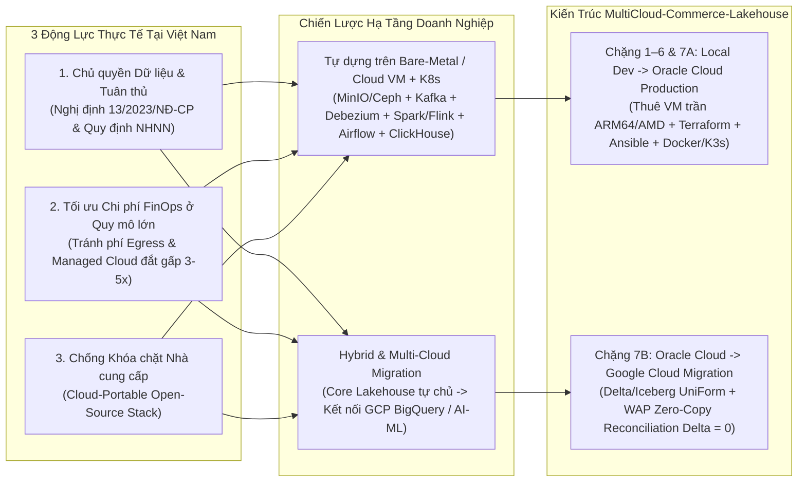

# Khảo Sát Thị Trường Tuyển Dụng Data Engineer Việt Nam (2025–2026) & Đối Chiếu Kiến Trúc `MultiCloud-Commerce-Lakehouse`

> **Kết luận cốt lõi (BLUF):** Khảo sát diện rộng các tin tuyển dụng (JD) và thảo luận kỹ thuật trên LinkedIn, ITviec, TopDev, Robert Walters Vietnam, Workport, CareerLink cùng các cộng đồng Data tại Việt Nam chứng minh rằng thị trường đang phân hóa sâu sắc thành **2 phân khúc Kỹ sư Dữ liệu**. Dự án **[`MultiCloud-Commerce-Lakehouse: Real-Time & Batch Data Platform — From Local Dev to Oracle Cloud Production & Google Cloud Migration`](../../README.md)** được thiết kế có chủ đích để giải quyết trọn vẹn bài toán của **Phân khúc 2 (Core Data Platform, Lakehouse & Real-Time Streaming Engineer — dải lương `40–70 triệu VNĐ` cấp Senior và `60–120 triệu+ VNĐ` cấp Lead/Principal)** tại khối Ngân hàng TMCP, Tài chính tiêu dùng, Fintech và Siêu ứng dụng (`[Verified]`: `robertwalters.com.vn`, `workport.vn`, `careerlink.vn`, truy cập `2026-10-25`).

---

## 1. Thị Trường Data Engineer Việt Nam Phân Hóa Thành Hai Phân Khúc Với Chênh Lệch Thu Nhập Gấp 2–3 Lần

Sự bùng nổ dữ liệu giao dịch số (QR Payment, E-Wallet, Super-App, E-Commerce) và làn sóng hiện đại hóa Core Banking đã tách bạch rõ rệt vai trò của một **Core Data Platform / Lakehouse Engineer** khỏi công việc ETL/BI truyền thống. Những ứng viên chỉ dừng ở mức viết SQL/Stored Procedure trên kho dữ liệu dựng sẵn đang đối mặt với sự bão hòa, trong khi nhóm kỹ sư làm chủ được **Distributed Streaming (`Kafka`, `Debezium`, `Flink`), Open Table Formats (`Delta Lake`, `Apache Iceberg`), và Hạ tầng Container/IaC (`Docker`, `Kubernetes`, `Terraform`)** luôn nằm trong tình trạng khan hiếm nhân sự cấp cao (`[Verified]`: `robertwalters.com.vn`, `workport.vn`, `careerlink.vn`, truy cập `2026-10-25`).

| Tiêu chí so sánh | Phân khúc 1: BI / Reporting / Traditional ETL DE | Phân khúc 2: Core Data Platform / Lakehouse & Streaming DE *(Mục tiêu của Repo này)* |
| :--- | :--- | :--- |
| **Đặc trưng công việc** | Viết SQL View, Stored Procedure trên Oracle / SQL Server; kéo thả SSIS / DataStage chạy batch cố định ban đêm; chuẩn bị bảng cho PowerBI / Superset. | Xây dựng đường ống **CDC thời gian thực** không làm nghẽn DB nguồn; xử lý luồng sự kiện độ trễ thấp; thiết kế **Medallion Lakehouse**; kiểm toán **Data Quality / Reconciliation** và tự động hóa hạ tầng **VM / K8s bằng Terraform & Ansible**. |
| **Loại hình doanh nghiệp** | Doanh nghiệp SME, công ty phi công nghệ truyền thống, hoặc dự án phần mềm nhỏ. | **Ngân hàng TMCP Tier-1/Tier-2, Công ty Tài chính Tiêu dùng, Ví điện tử / Cổng thanh toán, Siêu ứng dụng, Tập đoàn Viễn thông.** |
| **Điểm nghẽn khi phỏng vấn** | Lúng túng trước các sự cố hệ thống phân tán: *Data Skew làm treo Spark*, *Kafka Consumer Lag*, *Late Arrival làm lệch báo cáo*, *Small-file Storm trên Object Storage*. | Giải quyết từ gốc cơ chế vật lý: cấu hình `REPLICA IDENTITY FULL` cho WAL, xử lý Skew bằng AQE/Salting, khử trùng lặp bằng Flink Keyed State TTL, đóng cổng kiểm toán Write-Audit-Publish (WAP). |
| **Khung lương tham khảo tại VN** | `15 – 35 triệu VNĐ/tháng` (Junior – Middle) (`[Verified]`: `careerlink.vn`, `2026-10-25`). | `40 – 70 triệu VNĐ/tháng` (Senior) và `60 – 120 triệu+ VNĐ/tháng` (Lead / Principal / Architect) (`[Verified]`: `careerlink.vn`, `robertwalters.com.vn`, `2026-10-25`). |

---

## 2. Doanh Nghiệp Lớn Tại Việt Nam Ưu Tiên Tự Dựng Hệ Sinh Thái Open-Source Trên VM / Kubernetes Hơn Là Dùng Managed Service "Mì Ăn Liền"

Trái với suy nghĩ phổ biến rằng doanh nghiệp chỉ việc mua các dịch vụ Cloud "mì ăn liền" (Managed Services như Fivetran, Confluent Cloud hay Snowflake), thực tế vận hành tại các ngân hàng, tập đoàn viễn thông và kỳ lân công nghệ Việt Nam lại đặt trọng tâm vào mô hình **Tự quản trị trên cụm Server riêng / Cloud VM (`Self-Managed on VMs / Private Cloud Kubernetes`)** hoặc **Kiến trúc Lai (`Hybrid Cloud`)** (`[Verified]`: `vng.com.vn`, `vietinbank.vn`, `greennode.ai`, `itjobs.com.vn`, `cmcglobal.com.vn`, truy cập `2026-10-25`).

Ba nguyên nhân cốt lõi lý giải tại sao hướng đi **"Thuê VM trần rồi tự dựng toàn bộ từ gốc bằng Docker, K3s, Terraform và Ansible"** trong dự án này lại sát thực tế tuyển dụng nhất:

1. **Rào cản Pháp lý & Chủ quyền Dữ liệu (Data Sovereignty — Nghị định 13/2023/NĐ-CP & Ngân hàng Nhà nước):** Dữ liệu giao dịch lõi và thông tin định danh cá nhân (PII) tại các ngân hàng (**VietinBank, MB Bank, VPBank, ACB**) hay cổng thanh toán/viễn thông (**VNPay, Viettel, MoMo, VNG**) bắt buộc phải được kiểm soát nghiêm ngặt tại Data Center nội địa hoặc Private Cloud (`[Verified]`: `itjobs.com.vn`, `vietinbank.vn`, `ub.edu.vn`, `2026-10-25`). Trong môi trường Private Cloud hoặc cụm máy ảo nội địa đó không tồn tại sẵn các dịch vụ Managed độc quyền của AWS/GCP; kỹ sư bắt buộc phải tự triển khai **`MinIO`/`Ceph` (S3 Object Storage) + `Kafka` + `Debezium` + `Spark`/`Flink` + `Airflow` + `ClickHouse` trên `Kubernetes`** (`[Verified]`: `greennode.ai`, `vng.com.vn`, `2026-10-25`).
2. **Bài toán Kinh tế Học Đám mây (FinOps) khi Lưu lượng Cao:** Ở quy mô hàng chục triệu giao dịch thanh toán QR mỗi ngày hoặc hàng tỷ dòng sự kiện hành vi người dùng, việc trả tiền theo dung lượng quét và băng thông mạng (Egress) cho các dịch vụ Managed Cloud khiến chi phí vận hành (OpEx) đội lên gấp 3–5 lần so với việc thuê cụm máy chủ/VM cố định và tự tối ưu hóa `ClickHouse`, `Spark`, `Kafka` (`[Verified]`: `cmcglobal.com.vn`, `careerlink.vn`, `2026-10-25`).
3. **Quy luật Bất đối xứng khi Phỏng vấn Kỹ thuật:** Một kỹ sư đã tự tay dựng, đo kiểm và cứu lỗi toàn bộ đường ống Open-Source trên máy ảo Linux/K8s khi chuyển sang dùng dịch vụ Managed (`Google Dataproc`, `BigQuery`, `AWS EMR`) chỉ mất vài giờ để làm quen giao diện. Ngược lại, người chỉ quen dùng dịch vụ "mì ăn liền" sẽ bị loại ngay ở vòng System Design khi gặp các câu hỏi về cấu hình `WAL Logical`, `Spark Executor OOM (Exit Code 137)`, hay `RocksDB State Checkpoint` (`[Verified]`: `careerlink.vn`, `itjobs.com.vn`, `2026-10-25`).

---

## 3. Ánh Xạ 1:1 Giữa JD Của Các Tập Đoàn Hàng Đầu Việt Nam Và Từng Phân Hệ Trong Dự Án

Bảng dưới đây đối chiếu trực tiếp các yêu cầu kỹ thuật từ tin tuyển dụng thực tế của các định chế tài chính, ngân hàng và siêu ứng dụng tại Việt Nam với các mô-đun được xây dựng trong [`MultiCloud-Commerce-Lakehouse`](../../README.md):

| Nhóm Doanh nghiệp tiêu biểu | Yêu cầu Kỹ thuật & Bài toán Thực tế trong JD (`[Verified]`) | Thành phần Giải quyết Trực tiếp trong Dự án Này (Kèm Link Tài liệu) |
| :--- | :--- | :--- |
| **Home Credit Vietnam** & Khối Tài chính Tiêu dùng | • **Di dời dữ liệu lịch sử (Legacy DWH Migration)** từ hệ thống cũ (Oracle/Teradata) lên Lakehouse hiện đại. • **Đối soát số liệu song song (`Reconciliation`)** đảm bảo không lệch số liệu tài chính. • Xử lý luồng sự kiện Mobile App phục vụ chấm điểm tín dụng (Credit Scoring) & chống gian lận; điều phối bằng `Airflow` + `dbt` (`[Verified]`: `workport.vn`, `nganhang.com`, `2026-10-25`). | • Bảng nguồn đối chứng `legacy_daily_revenue_report` trong [DATA_SOURCE_AND_SIMULATION.md](DATA_SOURCE_AND_SIMULATION.md). • Cổng kiểm toán tự động **WAP Zero-Copy Reconciliation (`Delta = 0`)** bằng `DuckDB` + `PyArrow` ([PROJECT_SOLUTION.md](../architecture/PROJECT_SOLUTION.md)). • Bảng Gold `feat_customer_order_metrics_90d` & `label_customer_reorder_7d` chuẩn Point-in-Time. |
| **Techcombank, VPBank (Cake by VPBank), ACB** | • **Techcombank:** Hiện đại hóa dữ liệu lên Cloud Lakehouse ("Customer Brain" >16 triệu KH) với **`Kafka`, `Spark`, `Delta Lake`, `Terraform`**. • **Cake by VPBank:** Xây dựng Lakehouse thế hệ mới dùng **`Apache Iceberg`, `Google BigQuery`, Real-time CDC**. • **ACB:** Tuyển dụng DE làm chủ `Spark`, `Airflow`, `Lakehouse` và `Terraform` IaC (`[Verified]`: `techcombank.com`, `vpbank.com.vn`, `acbjobs.com.vn`, `databricks.com`, `monster.com.vn`, `2026-10-25`). | • **Delta Lake 3.x bật `UniForm (IcebergCompatV2)`**: Ghi 1 lần trên `MinIO`/Object Storage nhưng đọc được đồng thời cả chuẩn **Delta Lake** lẫn **Apache Iceberg** ([PROJECT_SOLUTION.md](../architecture/PROJECT_SOLUTION.md)). • Tối ưu **Spark AQE + Salting + Compaction + Z-Order**. • Kịch bản **Oracle Cloud Production $\rightarrow$ Google Cloud Migration** bằng `Terraform`. |
| **VietinBank, MB Bank** (Ngân hàng TMCP Quốc doanh / Quân đội) | • Vận hành hạ tầng **On-Premise / Hybrid Big Data (`Kafka`, `Spark`, `Airflow`, `MinIO/Ceph`)**. • Tuân thủ nghiêm ngặt quy định bảo mật của NHNN và **Nghị định 13/2023/NĐ-CP** (ẩn danh/mã hóa dữ liệu nhạy cảm PII, phân vùng mạng cô lập) (`[Verified]`: `vietinbank.vn`, `ub.edu.vn`, `nganhang.com`, `2026-10-25`). | • Mã hóa băm một chiều **SHA-256 PII Hashing** cho `email`, `phone`, `national_id`, `card_bin` trong `dbt` ([DATA_SOURCE_AND_SIMULATION.md](DATA_SOURCE_AND_SIMULATION.md)). • Quản lý bí mật tập trung bằng **HashiCorp Vault**, gắn nhãn PII và truy vết dòng chảy dữ liệu trên **DataHub**. |
| **MoMo, VNPay, ZaloPay** (Fintech) & **VNG, Grab, Be Group, KiotViet** (Siêu App / SaaS) | • Bắt biến động giao dịch thời gian thực bằng **`Debezium CDC` + `Apache Kafka`** mà không gây khóa bảng DB OLTP. • Dùng **`Apache Flink`** xử lý Stateful Streaming (khử trùng lặp webhook thanh toán, xử lý bản tin đến trễ). • Xây dựng kho OLAP tốc độ cao bằng **`dbt` + `ClickHouse`** trên **`Kubernetes`** (`[Verified]`: `careerlink.vn`, `vng.com.vn`, `be.com.vn`, `kiotviet.vn`, `robertwalters.com.vn`, `2026-10-25`). | • Đường ống **`PostgreSQL 16 (wal_level=logical + REPLICA IDENTITY FULL) → Debezium → Kafka KRaft → Apache Flink (Watermarks, RocksDB State TTL, Dedup) → ClickHouse`**. • Đóng gói toàn bộ bằng Multi-stage `Dockerfile` (giảm `71%` dung lượng) và triển khai lên **K3s Kubernetes** ([STEP_BY_STEP_BUILD_GUIDE.md](../runbooks/STEP_BY_STEP_BUILD_GUIDE.md)). |

---

## 4. Năm Bài Toán "Sát Hạch" Phỏng Vấn Senior DE Được Mô Phỏng Và Giải Quyết Tận Gốc Trong Repo

Thay vì xây dựng một đường ống chỉ chạy trên dữ liệu "sạch giả tạo", dự án này chủ động bơm (inject) **5 sự cố kinh điển của môi trường Production** (thường xuyên xuất hiện trong các vòng phỏng vấn System Design tại Việt Nam) và chứng minh giải pháp bằng số đo thực nghiệm:

| # | Câu hỏi "Sát hạch" trong Phỏng vấn & Cộng đồng Data VN | Cơ chế Gây lỗi được Mô phỏng trong Dự án | Giải pháp Kỹ thuật & Bằng chứng Nghiệm thu trong Repo |
| :--- | :--- | :--- | :--- |
| **1** | *"Bật CDC trên DB giao dịch gặp lệnh `UPDATE/DELETE` bị thiếu giá trị cũ hoặc làm đầy đĩa WAL thì xử lý thế nào?"* | Giao dịch `orders`, `payments`, `inventory_items` liên tục cập nhật trạng thái trên PostgreSQL 16. | Bật `wal_level=logical` ([docker-compose.yml](../../docker-compose.yml)), thiết lập `REPLICA IDENTITY FULL` cho bảng giao dịch và cấu hình `heartbeat.interval.ms` trên Debezium. |
| **2** | *"Webhook thanh toán bắn trùng (`at-least-once`) và mạng di động trễ 5–10 phút làm sai lệch doanh thu theo khung giờ thì chặn ở đâu?"* | Luồng `payment_callbacks` bơm `~1.5%` bản tin trùng lặp; luồng `clickstream` bơm bản tin trễ `5–10 phút` + bản tin rác sai schema. | **Apache Flink** cấu hình `BoundedOutOfOrdernessWatermarks` + `SideOutput` (bắt dữ liệu trễ), `KeyedProcessFunction` + `RocksDB State TTL` (khử trùng lặp), và cô lập bản tin hỏng vào `dlq_poison_events`. |
| **3** | *"Job Spark vào ngày Sale lớn bị treo ở task `199/200` và báo lỗi OOM do lệch dữ liệu (Data Skew) thì tối ưu ra sao?"* | Bộ sinh dữ liệu `commerce-datagen` tạo phân phối **Zipfian Skew** (`80%` đơn hàng tập trung ở TP.HCM / Hà Nội và nhóm Seller/Category lớn). | Chạy đối chứng **Baseline vs. Optimized** trên Spark: bật **AQE Skew Join** kết hợp **Key Salting** và chụp bằng chứng trực tiếp từ **Spark UI** ([IMPLEMENTATION_CHECKLIST.md](../roadmap/IMPLEMENTATION_CHECKLIST.md)). |
| **4** | *"Hệ thống chạy liên tục 24/7 sinh ra hàng vạn file Parquet nhỏ và phình bộ nhớ trạng thái thì duy trì độ ổn định (Day-2 Maintenance) thế nào?"* | Ghi micro-batch và streaming liên tục xuống tầng Bronze/Silver trên `MinIO` S3. | Áp dụng **Day-2 Maintenance Controls**: gộp file nhỏ bằng `OPTIMIZE ... ZORDER BY`, dọn file hết hạn bằng `VACUUM`, cài đặt `State TTL` cho Flink và kiểm chứng khả năng xả lũ (`Backlog Catch-up`) ([PROJECT_SOLUTION.md](../architecture/PROJECT_SOLUTION.md)). |
| **5** | *"Khi migrate từ hạ tầng cũ (Oracle Cloud / On-Prem) sang Google Cloud, làm sao chứng minh với Giám đốc Tài chính không mất hay lệch 1 đồng nào?"* | Chạy song song báo cáo nguyên khối cũ (`legacy_daily_revenue_report`) và đường ống Lakehouse đa đám mây mới. | Thực thi **WAP Zero-Copy Reconciliation Gate** bằng `DuckDB`/`PyArrow`: tự động đối chiếu tổng tiền và số đơn giữa 2 hệ thống; chỉ khi `Delta = 0.00` mới cho phép xuất bản sang `ClickHouse` và `Google Cloud`, nếu lệch tự động `RESTORE TABLE` (Time Travel). |

---

## 5. Liên Kết Nhanh Tới Hệ Thống Tài Liệu Cốt Lõi Của Dự Án

- **Trang chủ & Tổng quan Kiến trúc:** [README.md](../../README.md)
- **Sổ tay Thực hành Cầm tay Chỉ việc (Step-by-Step Build & Learning Guide):** [docs/runbooks/STEP_BY_STEP_BUILD_GUIDE.md](../runbooks/STEP_BY_STEP_BUILD_GUIDE.md)
- **Kiến trúc Chi tiết & Quyết định Thiết kế (ADR / Capacity Planning / Multi-Cloud):** [docs/architecture/PROJECT_SOLUTION.md](../architecture/PROJECT_SOLUTION.md)
- **Đặc tả Nguồn Dữ liệu, Từ điển 165 Cột & Mô phỏng Lỗi:** [docs/research/DATA_SOURCE_AND_SIMULATION.md](DATA_SOURCE_AND_SIMULATION.md)
- **Bảng Kiểm 7 Chặng Thực thi (100/100 Điểm DE Rubric):** [docs/roadmap/IMPLEMENTATION_CHECKLIST.md](../roadmap/IMPLEMENTATION_CHECKLIST.md)

