# Step-by-Step Build Guide — Enterprise Commerce Data Platform

> **Mục tiêu dự án:** Xây dựng Data Platform chuẩn doanh nghiệp (`Kafka, Spark, Flink, Delta Lake, dbt, ClickHouse, Airflow, DataHub`), xử lý `>= 100 GB` Batch và tốc độ `200–500 MB/s` (đỉnh `0.5–1 GB/s`).

---

## 📌 BẢN ĐỒ TỔNG THỂ 7 STAGES & CHỐT CHẶN RUBRIC (MASTER ROADMAP — 100/100 ĐIỂM DE)

### Sơ đồ Luồng Thực Thi Tuần Tự (Sequential Build & Cloud Promotion Flow)

```mermaid
flowchart TD
    subgraph S0["STAGE 0: NỀN TẢNG LOCAL & CLOUD TENANCY (ĐÃ XONG 100%)"]
        B1["Bước 1–7: Ubuntu 24.04 ARM64 (OrbStack)\nUser dev + Docker + Git/GitHub + .env"]
        B7_1["Bước 7.1: Oracle Cloud (us-phoenix-1)\nTenancy CloudBigDataPlatform + oci-cloud MCP\n+ Terraform Dry-Run (AD-1 ARM64 + AD-2 AMD)"]
        B1 --> B7_1
    end

    subgraph S1["STAGE 1: STORAGE CORE & CONTAINER OPTIMIZATION (5 ĐIỂM)"]
        B8["Bước 8–8.2: PostgreSQL 16 (WAL=logical)\n+ MinIO S3 (Verified: 878 MB/s Write)"]
        B9["Bước 9–10: Makefile chuẩn hóa lệnh\n(make up/down/ps/logs/test) + Git Push"]
        B11["Bước 11 (R3–R4 | 5đ): Multi-stage Dockerfile\n(uv/wheel + slim non-root, giảm >60% size)"]
        B8 --> B9 --> B11
    end

    subgraph S2["STAGE 2: VECTORIZED GENERATOR (>=100 GB) & CDC INGESTION (12 ĐIỂM)"]
        B12["Bước 12–13: OLTP Schema + Legacy SQL Report\n+ FastAPI Order Service (Pydantic)"]
        B14["Bước 14 (R5–R8 | 8đ): PyArrow/DuckDB Generator\n(>=100GB Batch: Skew 80%, Schema Evol, Dup 2%)"]
        B15["Bước 15 (R9–R10 | 4đ): Kafka KRaft + Debezium CDC\n+ DLQ (Stream Late 5-10m & Dup 1.5%)"]
        B12 --> B14 --> B15
    end

    subgraph S3["STAGE 3: REAL-TIME STREAMING — APACHE FLINK (10 ĐIỂM)"]
        B16["Bước 16–17 (R16–R17 | 5đ): Flink Baseline\n+ Watermarks & Side Outputs (Late 5-10m)"]
        B18["Bước 18–19 (R18–R19 | 5đ): KeyedProcessFunction\n(StateTTL Dedup 1.5%) + Windows -> Delta Bronze"]
        B16 --> B18
    end

    subgraph S4["STAGE 4: BATCH LAKEHOUSE — APACHE SPARK & DELTA/ICEBERG UNIFORM (16 ĐIỂM)"]
        B20["Bước 20 (R11–R15 | 13đ): Spark Bronze -> Silver\n(AQE/Salting Skew, Schema Merge, Dedup 2%)"]
        B21["Bước 21 (R20 | 3đ): Delta Lake Optimization\n(Partitioning, ZSTD, OPTIMIZE, Z-ORDER + Iceberg UniForm)"]
        B20 --> B21
    end

    subgraph S5["STAGE 5: DIMENSIONAL MODELING (dbt) & OLAP (ClickHouse) (13 ĐIỂM)"]
        B22["Bước 22 (R34–R38 | 10đ): dbt Core (staging/int/marts)\nSCD Type 2 + SHA-256 PII + Slim CI + feat_ table"]
        B23["Bước 23 (R21 | 3đ): ClickHouse Serving\n(ReplacingMergeTree, Skipping Index, MatViews)"]
        B22 --> B23
    end

    subgraph S6["STAGE 6: ORCHESTRATION (Airflow 3) & GOVERNANCE (DataHub) (24 ĐIỂM)"]
        B24["Bước 24 (R22–R27 | 12đ): Airflow 3 DAGs (DP1, DP2, DP3)\n+ Custom OOP Plugins (WAPOperator, CHHook + pytest)"]
        B25["Bước 25 (R28–R33 | 12đ): DataHub End-to-End Lineage\n+ PII Classification Tags + Quality Assertions"]
        B24 --> B25
    end

    subgraph S7["STAGE 7: WAP RECONCILIATION, OBSERVABILITY & OCI CLOUD IaC (20 ĐIỂM)"]
        B26["Bước 26 (R39 | 10đ): WAP Zero-Copy Gate (DuckDB)\nĐối chiếu Legacy SQL vs Gold (Lệch != 0 -> RESTORE)"]
        B27["Bước 27 (R40A | 5đ): Soak/Burst Benchmark (0.5-1 GB/s)\n+ Prometheus/Grafana/Loki + Vault + NGINX"]
        B28["Bước 28 (R40B | 5đ): Promote lên Oracle Cloud (us-phoenix-1)\nTerraform VCN/VM + Ansible ZRAM + K3s Helm/ArgoCD"]
        B26 --> B27 --> B28
    end

    subgraph NEXT["MỞ RỘNG SAU KHI XONG DE FOUNDATION (FULL-STACK DATA + ML + AI)"]
        ML["Phase 8 — ML Platform:\nFeast Feature Store + Kubeflow + MLflow + KServe"]
        LLM["Phase 9 — LLM/Agent Platform:\nRAG Ingestion + Vector Store + MCP Tools + Agents"]
    end

    S0 --> S1 --> S2
    S2 --> S3 & S4
    S3 & S4 --> S5 --> S6 --> S7
    S7 -.-> ML & LLM
```



### Bảng Theo Dõi Tiến Độ Từng Bước (Step-by-Step Checklist)

```text
====================================================================================================
[STAGE 0: CHUẨN BỊ MÁY CHỦ LINUX LOCAL & ORACLE CLOUD TENANCY (FOUNDATION)]                 [0 pts]
  ├── Bước 1: Tạo máy chủ Ubuntu 24.04 LTS trên OrbStack (16GB RAM dynamic, 183GB SSD)     [✔ Xong]
  ├── Bước 2: Tạo user 'dev' & cấp Full quyền Admin (sudo NOPASSWD:ALL)                    [✔ Xong]
  ├── Bước 3: Cài đặt git, make, docker.io, docker-compose-v2                              [✔ Xong]
  ├── Bước 4: Nối thư mục dự án (Symlink) & Khởi tạo Git Local (nhánh main)                [✔ Xong]
  ├── Bước 5: Tạo SSH Key ed25519 & Xác thực kết nối GitHub Web                            [✔ Xong]
  ├── Bước 6: Tạo GitHub Repo, giữ khung thư mục (.gitkeep) & Push lần đầu                 [✔ Xong]
  ├── Bước 7: Thiết lập biến môi trường bảo mật (.env.example & .env)                      [✔ Xong]
  └── Bước 7.1: Đăng ký Oracle Cloud (us-phoenix-1: CloudBigDataPlatform), kết nối         [✔ Xong]
                oci-cloud MCP + oci-cli + Terraform (41 OCPU/277GB Trial & Always Free)
        │
        ▼  [Gate 0 Passed: Local Linux ARM64 + GitHub + Oracle Cloud IaC sẵn sàng 100%]
====================================================================================================
[STAGE 1: CONTAINER FOUNDATION, STORAGE CORE & DOCKERFILE OPTIMIZATION]                     [5 pts]
  ├── Bước 8: Viết 'docker-compose.yml' & Bật riêng lẻ PostgreSQL 16 (WAL) + MinIO S3      [✔ Xong]
  ├── Bước 8.1: Nắm vững bộ lệnh vận hành & gỡ lỗi Docker hàng ngày                        [✔ Xong]
  ├── Bước 8.2: Đo Benchmark thực tế trong Linux VM (MinIO 878 MB/s, Postgres 216 MB/s)    [✔ Xong]
  ├── Bước 9: Viết 'Makefile' chuẩn hóa bảng điều khiển lệnh tắt (make up/down/ps/logs)    [✔ Xong]
  ├── Bước 10: Commit & Push mốc hạ tầng lưu trữ cốt lõi lên GitHub                        [✔ Xong]
  └── Bước 11 (R3–R4 | 5đ): Tối ưu Multi-stage Dockerfile (Baseline vs Slim Non-Root)      ◄── ĐANG Ở ĐÂY
        │
        ▼  [Gate 1: Storage Healthy + Bằng chứng giảm >60% kích thước Docker Image]
====================================================================================================
[STAGE 2: COMMERCE DATA GENERATOR (>= 100 GB + STREAM) & CDC INGESTION]                    [12 pts]
  ├── Bước 12: Thiết kế Schema OLTP PostgreSQL (customers, products, orders, payments...) + Legacy SQL Report
  ├── Bước 13: Xây dựng FastAPI Order Service (Pydantic Validation + Healthcheck)
  ├── Bước 14 (R5–R8 | 8đ): Viết Vectorized Data Generator (PyArrow/DuckDB) sinh >=100GB Batch
  │            (Tiêm lỗi chủ đích: Skew 80% HCM/Electronics, Schema Evolution, Duplicate 2%)
  └── Bước 15 (R9–R10 | 4đ): Dựng Kafka (KRaft) + Debezium CDC + Dead-Letter Queue (DLQ)
               (Bắn Stream clickstream trễ 5–10 phút & payment_callbacks trùng lặp 1.5%)
        │
        ▼  [Gate 2: >=100GB Raw Parquet trên MinIO + CDC/Streaming chảy vào Kafka & DLQ]
====================================================================================================
[STAGE 3: REAL-TIME STREAM PROCESSING VỚI APACHE FLINK]                                    [10 pts]
  ├── Bước 16 (R16 | 2đ): Chạy Flink Baseline Job (chưa tối ưu) & thu thập Flink UI metrics
  ├── Bước 17 (R17 | 3đ): Xử lý dữ liệu đến trễ 5–10p (Bounded Watermarks + Allowed Lateness + Side Outputs)
  ├── Bước 18 (R18 | 3đ): Khử trùng lặp 1.5% realtime (KeyedProcessFunction + StateTtlConfig chống tràn RAM)
  └── Bước 19 (R19 | 2đ): Tính toán cửa sổ thời gian (Tumbling/Sliding Windows) & ghi xuống Delta Lake Bronze
        │
        ▼  [Gate 3: Flink UI chứng minh xử lý sạch Late Data & Duplicate không rò rỉ bộ nhớ]
====================================================================================================
[STAGE 4: BATCH PROCESSING VỚI APACHE SPARK & DELTA / ICEBERG UNIFORM LAKEHOUSE]           [16 pts]
  ├── Bước 20 (R11–R15 | 13đ): Spark Job Bronze (raw_) -> Silver (stg_): So sánh trước/sau khi tối ưu
  │            Skew (AQE + Key Salting), Schema Evolution (merge failure_reason) & Offline Dedup (2%)
  └── Bước 21 (R20 | 3đ): Tối ưu lưu trữ Lakehouse trên MinIO (Partitioning, ZSTD, OPTIMIZE Compaction,
               Z-ORDER BY) + Bật Delta UniForm ('delta.universalFormat.enabledFormats' = 'iceberg')
               sinh song song metadata Apache Iceberg chuẩn Banking Việt Nam trên cùng 1 bản Parquet
        │
        ▼  [Gate 4: Spark UI chứng minh hết Skew + Giảm số file nhỏ + Hỗ trợ kép Delta & Iceberg]
====================================================================================================
[STAGE 5: DIMENSIONAL MODELING (dbt), SLIM CI & OLAP SERVING WAREHOUSE (ClickHouse)]       [13 pts]
  ├── Bước 22 (R34–R38 | 10đ): Xây dựng dbt Core (staging/intermediate/marts -> dim_, fact_, obt_, feat_),
  │            SCD Type 2 (dbt snapshot), Jinja PII Masking (SHA-256), Slim CI (state:modified+) & xuất ERD
  └── Bước 23 (R21 | 3đ): Nạp Gold sang ClickHouse (MergeTree/ReplacingMergeTree) & tối ưu
               Primary/Sorting Keys, Data Skipping Indexes, Materialized Views
        │
        ▼  [Gate 5: dbt Slim CI chạy xanh + ClickHouse query nhanh gấp nhiều lần trước khi đánh Index]
====================================================================================================
[STAGE 6: ORCHESTRATION (Airflow 3) & END-TO-END DATA GOVERNANCE (DataHub)]                [24 pts]
  ├── Bước 24 (R22–R27 | 12đ): Dựng Airflow 3, viết Custom OOP Plugins (WAPReconciliationOperator,
  │            ClickHousePublishHook có pytest) & 3 DAGs chuẩn (DP1, DP2, DP3 gồm Ingest + Validate)
  └── Bước 25 (R28–R33 | 12đ): Tích hợp DataHub thu thập End-to-End Lineage, gắn Tag PII/Sensitive
               và hiển thị kết quả Data Quality Assertions trên giao diện DataHub
        │
        ▼  [Gate 6: 3 DAGs DP1/DP2/DP3 xanh mượt + DataHub hiển thị Lineage từ Postgres tới ClickHouse]
====================================================================================================
[STAGE 7: ENTERPRISE OPS, WAP RECONCILIATION, OBSERVABILITY & ORACLE CLOUD IaC]            [20 pts]
  ├── Bước 26 (R39 - Novel #1 | 10đ): Cổng kiểm duyệt WAP Zero-Copy & Đối chiếu di trú Legacy DW
  │            (DuckDB/PyArrow so khớp row_count/sum_amount với báo cáo SQL cũ; lệch != 0 tự động RESTORE TABLE)
  ├── Bước 27 (R40A - Novel #2A | 5đ): Soak Benchmark (200–500 MB/s sustained, 0.5–1 GB/s peak) +
  │            Observability & Security (Prometheus/Grafana/Loki + HashiCorp Vault + NGINX Gateway)
  └── Bước 28 (R40B - Novel #2B | 5đ): Full Cloud Promotion lên Oracle Cloud (us-phoenix-1):
               Terraform (AD-1 ARM64 A1.Flex + AD-2 AMD64 E2.1.Micro) + Ansible (Hardening/ZRAM/Keepalive)
               + K3s Kubernetes + Helm/ArgoCD GitOps (Giữ cụm Always Free sống vĩnh viễn $0/tháng)
        │
        ▼  [Gate 7 (FINAL): Đạt 100/100 điểm DE Rubric — Nền tảng sẵn sàng cắm tiếp ML (Feast) & AI/RAG]
====================================================================================================
```

---

## 💡 QUY TRÌNH BẬT / TẮT MÁY HÀNG NGÀY (DAILY ROUTINE)

| Nhu cầu | Nơi gõ lệnh | Lệnh thực thi | Mục đích |
| :--- | :--- | :--- | :--- |
| **Nghỉ làm / Đi ngủ (Tắt)** | Trong `dev@ubuntu` | `exit` hoặc `Ctrl + D` | Thoát terminal Linux về Mac |
| | Trên Mac | `orb stop ubuntu` | Tắt hẳn máy ảo, giải phóng 100% RAM/CPU |
| **Sáng làm việc (Bật)** | Trên Mac | `orb -m ubuntu -u dev` | Bật máy ảo và đăng nhập vào user `dev` |
| | Trong `dev@ubuntu` | `cd ~/EnterpriseDataPlatform_PRJ2026` | Nhảy vào đúng thư mục dự án |

---

## Chặng 0: Dựng Linux Server, Tạo User & Phân Quyền (Chuẩn Thực Tế VPS/Server)

> **Quy tắc thực tế:** Dù dùng VPS, Cloud VM hay Server công ty, quy trình chuẩn luôn là: **Bật Linux $\rightarrow$ Tạo user riêng (`dev`) thay cho `root` $\rightarrow$ Cài công cụ cần dùng $\rightarrow$ Cấp đúng quyền cho user đó**.

### Bước 1: Tạo máy chủ Ubuntu 24.04 LTS (trên OrbStack)
```bash
orb list                             # Kiểm tra danh sách máy ảo hiện có
orb create ubuntu:noble ubuntu       # Tạo Server Ubuntu 24.04 (tên mã: noble)
```

### Bước 2: Tạo tài khoản `dev` & cấp Full Quyền (`sudo` không cần mật khẩu)
- Khi cấp quyền `sudo` (`ALL=(ALL) NOPASSWD:ALL`), tài khoản `dev` có **100% quyền tối cao trên toàn bộ máy chủ** — bất cứ lệnh hệ thống hay công cụ nào chỉ cần gõ `sudo` ở đầu (hoặc thêm luôn vào nhóm `docker`) là chạy thẳng.
```bash
# 1. Tạo tài khoản 'dev' và cấp luôn quyền nhóm 'sudo' (Full Admin)
orb -m ubuntu -u root useradd -m -s /bin/bash -G sudo dev

# 2. Cho phép 'dev' gõ sudo chạy mọi thứ không bao giờ hỏi mật khẩu
orb -m ubuntu -u root sh -c 'echo "dev ALL=(ALL) NOPASSWD:ALL" > /etc/sudoers.d/dev && chmod 440 /etc/sudoers.d/dev'
```

### Bước 3: Đăng nhập vào `dev@ubuntu` & cài công cụ (`git`, `make`, `docker`)
```bash
orb -m ubuntu -u dev                                    # Đăng nhập vào Server với tài khoản 'dev'
cd ~                                                    # Về thư mục nhà (/home/dev)
df -h / && free -h && nproc                             # Kiểm tra nhanh ổ cứng, RAM, CPU

sudo apt update                                         # Cập nhật danh mục phần mềm
sudo apt install -y git make docker.io docker-compose-v2 # Cài Git, Make, Docker
# Ghi chú: 'docker.io' là engine chạy container đơn lẻ; 'docker-compose-v2' là công cụ điều phối nhiều container qua file yaml.

sudo usermod -aG docker dev && newgrp docker            # Cho phép chạy docker luôn không cần gõ sudo
```

---

## Chặng 1: Khởi Tạo Dự Án, Git & Biến Môi Trường (`.env`)

### Bước 4: Nối thư mục dự án vào `/home/dev` & khởi tạo Git
- **Giải thích lệnh Linux cơ bản:**
  - `ln -s <nguồn> <đích>`: Tạo đường dẫn tắt (Symlink) để Server Linux nhìn thấy thư mục từ máy thật macOS mà không cần copy tốn dung lượng.
  - `cd <đường_dẫn>`: Change Directory — chuyển con trỏ terminal vào thư mục được chỉ định.
  - `ls -la`: List All — liệt kê tất cả file và thư mục (kể cả file ẩn bắt đầu bằng dấu chấm `.`) kèm thông tin quyền, kích thước và ngày tạo.
- **Git (Local) vs GitHub (Cloud):**
  - Git chạy **100% offline trên máy**, chưa kết nối mạng nên **chưa cần đăng nhập tài khoản**.
  - `git config user.name` và `user.email` chỉ là **chữ ký offline** gắn vào mỗi mốc lưu (commit). Khi nào đẩy code lên mạng (`git push`) thì lúc đó mới cần đăng nhập GitHub.
```bash
# 1. Tạo đường dẫn tắt nối dự án từ macOS vào /home/dev của Linux Server
ln -s /Users/MAC/Documents/EnterpriseDataPlatform_PRJ2026 ~/EnterpriseDataPlatform_PRJ2026
cd ~/EnterpriseDataPlatform_PRJ2026                      # Nhảy vào thư mục dự án
ls -la                                                  # Liệt kê kiểm tra toàn bộ file trong dự án

# 2. Khởi tạo Git và các thư mục cấu trúc
git init -b main                                        # Khởi tạo kho theo dõi Git offline, nhánh chính 'main'
mkdir -p src tests infra docs/runbooks                  # Tạo khung thư mục (-p: tự tạo nếu chưa có)

# 3. Khai báo chữ ký tác giả (dùng email GitHub thật của bạn để sau này đẩy lên tự nhận diện)
git config --global user.name "Aric Nguyen"             # Tên hiển thị của bạn
git config --global user.email "you@example.com"        # Email gắn vào commit

# 4. Lưu mốc lịch sử đầu tiên
git status                                              # Xem trạng thái các file (được lọc qua .gitignore)
git add .gitignore README.md assignment docs            # Đưa file vào giỏ chuẩn bị lưu (Staging Area)
git commit -m "chore: initialize data platform repo"    # Đóng dấu lưu mốc lịch sử đầu tiên
```

### Bước 5: Cấu hình SSH Key kết nối GitHub Web
- **Bản chất:** SSH Key là chiếc chìa khóa điện tử giúp máy chủ Linux tự động xác thực danh tính với GitHub mà không cần gõ mật khẩu hay Token mỗi lần đẩy code.
```bash
# 1. Tạo cặp khóa SSH ed25519 (chuẩn mã hóa hiện đại, bấm Enter 3 lần liên tục để chọn mặc định)
ssh-keygen -t ed25519 -C "email-github-cua-ban@gmail.com"

# 2. In khóa công khai (Public Key) ra màn hình
cat ~/.ssh/id_ed25519.pub
# -> Bôi đen copy toàn bộ dòng 'ssh-ed25519 AAAAC3NzaC1...'

# 3. Thêm khóa vào GitHub Web:
# Truy cập https://github.com/settings/keys -> Chọn "New SSH key" -> Dán khóa -> Bấm "Add SSH key"

# 4. Kiểm tra kết nối từ Linux lên GitHub
ssh -T git@github.com
# -> Khi hỏi (yes/no) gõ 'yes'. Hiện 'Hi <username>! You've successfully authenticated...' là chuẩn 100%!
```

### Bước 6: Tạo Repository trên GitHub & Push code lần đầu (Initial Push)
- **Quy trình chuẩn:** 
  1. Lên https://github.com/new tạo repo trống (không tick README hay gitignore).
  2. Gắn địa chỉ Remote (dạng SSH `git@github.com:...`).
  3. Gom toàn bộ file ban đầu vào commit và đẩy lên nhánh `main`.
```bash
# 1. Gom toàn bộ file khung sườn và lưu mốc commit
git add .
git commit -m "feat: initialize enterprise data platform structure and documentation" || true

# 2. Gắn đường dẫn Remote SSH của repo GitHub (thay đúng username của bạn)
git remote remove origin 2>/dev/null || true
git remote add origin git@github.com:ankinguyen-engineer-2002/EnterpriseBigDataPlatform.git

# 3. Đặt tên nhánh chính là 'main' và đẩy toàn bộ lên GitHub
git branch -M main
git push -u origin main
```

### Bước 6.1: Cẩm Nang Lệnh Git Hàng Ngày (Daily Git Workflow - Đủ Dùng, Thực Chiến)
- **Quy trình 1: Lưu code & Đẩy lên GitHub sau mỗi tính năng**
  ```bash
  git status                         # 1. Kiểm tra xem mình vừa tạo/sửa những file nào
  git diff                           # 2. Xem chi tiết từng dòng code vừa thay đổi (bấm 'q' để thoát)
  git add <tên_file>                 # 3. Gom file cụ thể vào giỏ (hoặc 'git add .' để gom hết)
  git commit -m "feat: mo_ta_ngan"   # 4. Đóng dấu commit kèm thông điệp rõ ràng
  git push origin main               # 5. Đẩy code lên GitHub
  ```

- **Quy trình 2: Lấy code mới nhất về máy (khi làm việc nhóm hoặc đổi máy)**
  ```bash
  git pull origin main               # Kéo toàn bộ code mới nhất từ GitHub về máy
  ```

- **Quy trình 3: Kiểm tra lịch sử commit**
  ```bash
  git log --oneline -n 5             # Xem 5 commit gần nhất trên 1 dòng cực gọn
  ```

- **Quy trình 4: "Cứu cánh" khi lỡ tay gõ sai**
  ```bash
  git restore <tên_file>             # Hủy bỏ thay đổi của 1 file khi CHƯA gõ 'git add'
  git restore --staged <tên_file>    # Bỏ file ra khỏi giỏ chuẩn bị commit (sau khi lỡ 'git add')
  ```

### Bước 7: Quản lý biến môi trường bảo mật (`.env.example` & `.env`)
- **Quy chuẩn bảo mật IT:** 
  - Không bao giờ đưa tài khoản/mật khẩu vào code đẩy lên Git.
  - `.env.example`: Chứa khung biến mẫu, **được commit lên Git** để đồng đội biết hệ thống cần những tham số nào.
  - `.env`: Chứa mật khẩu thật chạy cục bộ, **bắt buộc bị `.gitignore` chặn lại**.
```bash
# 1. Tạo file cấu hình mẫu .env.example
cat << 'EOF' > .env.example
COMPOSE_PROJECT_NAME=edp_commerce
POSTGRES_USER=edp_admin
POSTGRES_PASSWORD=edp_secret_2026
POSTGRES_DB=commerce_oltp
POSTGRES_PORT=5432
MINIO_ROOT_USER=minio_admin
MINIO_ROOT_PASSWORD=minio_secret_2026
MINIO_API_PORT=9000
MINIO_CONSOLE_PORT=9001
EOF

# 2. Nhân bản sang file cấu hình thật .env để container đọc lúc khởi chạy
cp .env.example .env

# 3. Kiểm tra danh sách file (thấy cả .env và .env.example)
ls -la
```

---

## Chặng 2: Hạ Tầng Lưu Trữ Cốt Lõi (PostgreSQL 16 & MinIO S3)

### 📌 Phân Biệt: Cụm Kiến Trúc Logic vs Container Độc Lập Thực Tế
- **Cụm kiến trúc** là sự phân chia về mặt **tư duy hệ thống** (để biết cái nào làm gì, cái nào dựng trước).
- **Thực tế trên Docker:** **1 Dịch Vụ = 1 Container Riêng Biệt**. Tuyệt đối KHÔNG gộp chung Postgres với MinIO, hay Kafka với Debezium vào cùng 1 container.

| Cụm Kiến Trúc (Tư duy Logic) | Mỗi dịch vụ = 1 Container ĐỘC LẬP HOÀN TOÀN | Cơ chế giao tiếp |
| :--- | :--- | :--- |
| **1. Storage Core (Nơi chứa)** | • Container 1: `edp_postgres` (DB nguồn OLTP)<br>• Container 2: `edp_minio` (Data Lake S3) | **Mạng chung `edp_network`:** Như một Switch mạng LAN ảo nối tất cả container lại với nhau. |
| **2. Streaming Bus (Nơi truyền)** | • Container 3: `edp_kafka` (Message Broker)<br>• Container 4: `edp_debezium` (CDC Connector) | **Giao tiếp nội bộ:** Các container tự gọi nhau bằng tên service (VD: `postgres:5432`, `minio:9000`). |
| **3. Compute Engine (Nơi tính toán)** | • Container 5: `edp_spark_master` (Master)<br>• Container 6: `edp_spark_worker` (Worker)<br>• Container 7: `edp_flink` (Stream Engine) | |
| **4. Serving & Governance (Báo cáo & Quản trị)** | • Container 8: `edp_clickhouse` (OLAP DB)<br>• Container 9: `edp_airflow` (Điều phối)<br>• Container 10: `edp_datahub` (Data Catalog) | |

- **Giải mã Port (`Port_Máy_Thật : Port_Nội_Bộ` - VD: `9001:9001`):**
  - **Port Máy Thật (Bên trái):** Mở ra `localhost` trên Mac để bạn mở trình duyệt xem giao diện Web (VD: `http://localhost:9001` vào MinIO Console).
  - **Port Nội Bộ (Bên phải):** Cổng bên trong container để các container khác tự kết nối ngầm với nhau qua `edp_network` (không cần qua localhost).
- **Thứ tự triển khai:** Dựng Chặng 2 (`Postgres` + `MinIO`) xong chạy khỏe $\rightarrow$ Mới dựng tiếp Chặng 3 (`Kafka` + `Debezium`) $\rightarrow$ Tránh sập máy vì thiếu RAM (OOM) và dễ dàng gỡ lỗi từng con.

---

### Bước 8: Viết `docker-compose.yml` & Bật 2 Container Lưu Trữ Cốt Lõi
- **Bản chất file YAML:** Theo chuẩn Docker Compose Specification quốc tế với 3 từ khóa gốc:
  1. `services:` Khai báo các container độc lập cần chạy (`postgres`, `minio`).
  2. `networks:` Khai báo mạng ảo switch `edp_network` để các container tự tìm thấy nhau qua DNS.
  3. `volumes:` Khai báo ổ cứng ảo lưu trữ vĩnh viễn (`pg_data`, `minio_data`) để xóa container không bị mất dữ liệu.
- **Giải phẫu bộ 3 cờ PostgreSQL CDC, Kiến trúc RAM $\rightarrow$ Disk & Bản chất Replica:**
  - `wal_level=logical`: Bắt Postgres dịch nhật ký nhị phân thô sang ngôn ngữ logic (bảng nào, dòng nào vừa Insert/Update) để Debezium đọc được.
  - `max_replication_slots=10`: Số lượng "chiếc kẹp sách" tối đa đánh dấu vị trí Debezium đang đọc tới đâu (chống mất dữ liệu khi rớt mạng).
  - `max_wal_senders=10`: Số lượng tiến trình tối đa mở ra để bốc dữ liệu WAL gửi qua mạng cho Debezium.
  - *Cơ chế bộ nhớ `Shared Buffers` / `WAL Buffers` (RAM) $\rightarrow$ `pg_wal` / `base/` (Disk):*
    ```text
    ================== TRÊN RAM (SHARED MEMORY) ==================
       [Câu lệnh INSERT / UPDATE]
            │
            ├──────────────────────────────┐
            ▼                              ▼
     [1. Shared Buffers (RAM)]      [2. WAL Buffers (RAM)]
     (Sửa bảng/index ngay trên RAM   (Ghi 1 dòng log ngắn gọn)
      -> Gọi là "Dirty Pages",             │
      CHƯA ghi xuống ổ cứng!)              │ Khi COMMIT: Flush ngay! (Ghi tuần tự siêu nhanh)
            │                              ▼
    ========│======================== TRÊN Ổ CỨNG (DISK) =========
            │                       [File nhật ký: pg_wal/]  ◄── [Replication Slot] ──► Debezium CDC
            │                        (Lưu tạm thời xoay vòng      (Kẹp giữ CẤM XÓA khi
            │                         như camera hành trình)       Debezium chưa đọc xong)
            │ Cứ 5 phút/lần (CHECKPOINT)
            │ Mới gom "Dirty Pages" đổ xuống đĩa 1 thể!
            ▼
     [File bảng thật: base/] (Lưu trạng thái cuối cùng vĩnh viễn)
    ```
  - *Lưu ý thực chiến Production:* `pg_wal` ghi xuống đĩa để chống mất điện khi `Shared Buffers` chưa kịp đổ xuống `base/`. Sau mỗi kỳ `Checkpoint` (5 phút), Postgres sẽ xóa `pg_wal` cũ để giải phóng đĩa. Nhờ có `Replication Slot`, Postgres bị cấm xóa các file `pg_wal` mà Debezium chưa đọc. Nhưng nếu Debezium chết nhiều ngày không ai sửa, `pg_wal` sẽ phình đầy ổ cứng làm sập DB (cần giới hạn bằng `max_slot_wal_keep_size`).
  - *Ý nghĩa Replica trong Big Data:* Ở đâu cũng có Replica (Postgres, Kafka, ClickHouse) nhằm 2 mục đích sống còn: **Chống mất dữ liệu khi sập máy (Fault Tolerance)** và **Chia tải đọc không làm nghẽn máy chính (Read Scaling)**.
  - `${POSTGRES_USER:-edp_admin}`: Cú pháp đọc biến từ `.env`, nếu không có thì lấy giá trị sau dấu `:-`.
  - `volumes: pg_data:/var/lib/...`: Ánh xạ ổ cứng container ra ổ cứng máy chủ để giữ dữ liệu an toàn.
  - `healthcheck`: Kiểm tra sức khỏe định kỳ mỗi 5s, khi sẵn sàng phục vụ mới báo trạng thái `healthy`.
  - `entrypoint` trong MinIO: Tự động tạo sẵn 5 bucket theo chuẩn Medallion (`raw`, `bronze`, `silver`, `gold`, `checkpoints`) ngay khi bật container.

```bash
# 1. Khai báo file docker-compose.yml chi tiết
cat << 'EOF' > docker-compose.yml
services:
  postgres:
    image: postgres:16.4-alpine
    container_name: edp_postgres
    restart: unless-stopped
    command: >
      postgres -c wal_level=logical
               -c max_wal_senders=10
               -c max_replication_slots=10
    environment:
      POSTGRES_USER: ${POSTGRES_USER:-edp_admin}
      POSTGRES_PASSWORD: ${POSTGRES_PASSWORD:-edp_secret_2026}
      POSTGRES_DB: ${POSTGRES_DB:-commerce_oltp}
    ports:
      - "${POSTGRES_PORT:-5432}:5432"
    volumes:
      - pg_data:/var/lib/postgresql/data
    healthcheck:
      test: ["CMD-SHELL", "pg_isready -U ${POSTGRES_USER:-edp_admin} -d ${POSTGRES_DB:-commerce_oltp}"]
      interval: 5s
      timeout: 5s
      retries: 5
    networks:
      - edp_network

  minio:
    image: alpine/minio:RELEASE.2025-10-15T17-29-55Z
    container_name: edp_minio
    restart: unless-stopped
    entrypoint: >
      /bin/sh -c "
      mkdir -p /home/minio/raw /home/minio/bronze /home/minio/silver /home/minio/gold /home/minio/checkpoints &&
      exec minio server /home/minio --console-address ':9001'
      "
    environment:
      MINIO_ROOT_USER: ${MINIO_ROOT_USER:-minio_admin}
      MINIO_ROOT_PASSWORD: ${MINIO_ROOT_PASSWORD:-minio_secret_2026}
    ports:
      - "${MINIO_API_PORT:-9000}:9000"
      - "${MINIO_CONSOLE_PORT:-9001}:9001"
    volumes:
      - minio_data:/home/minio
    healthcheck:
      test: ["CMD-SHELL", "wget -qO- http://127.0.0.1:9000/minio/health/live || exit 1"]
      interval: 5s
      timeout: 5s
      retries: 5
    networks:
      - edp_network

networks:
  edp_network:
    name: edp_network
    driver: bridge

volumes:
  pg_data:
    name: edp_pg_data
  minio_data:
    name: edp_minio_data
EOF

# 2. Quy trình gỡ lỗi chuyên nghiệp: Bật và nghiệm thu TỪNG CONTAINER ĐƠN LẺ
# (Tránh bật cả cụm để cô lập lỗi ngay từ đầu: con nào chết biết ngay con đó)

# Bước 2.1: Bật và kiểm tra riêng con PostgreSQL 16 (DB nguồn)
sudo docker compose up -d postgres
sudo docker compose ps postgres          # STATUS phải báo 'Up ... (healthy)'

# Bước 2.2: Bật và kiểm tra tiếp con MinIO S3 (Data Lake)
sudo docker compose up -d minio
sudo docker compose ps minio             # STATUS phải báo 'Up ... (healthy)'

# 3. Nghiệm thu thực tế trên trình duyệt web (Verification)
# - Truy cập MinIO Web UI: http://localhost:9001 (User: minio_admin, Pass: minio_secret_2026)
# - Kiểm tra mục Buckets: Thấy đủ 5 bucket Medallion tự động sinh ra!

# 4. Ghi chú kiến trúc tinh tế:
# - Vì sao MinIO có web còn Postgres thì không?
#   + MinIO có cổng 9001 là HTTP Web Server nên Chrome đọc được.
#   + Postgres mở cổng 5432 nhưng chạy giao thức DB nhị phân, muốn xem phải dùng DBeaver kết nối vào localhost:5432.
# - Vì sao có sẵn 5 bucket (raw, bronze, silver, gold, checkpoints)?
#   + Nhờ cờ 'entrypoint' chạy 'mkdir -p' trong docker-compose.yml. MinIO tự động map các thư mục này thành 5 Bucket S3 ngay khi vừa khởi động!
```

### Bước 8.1: Cẩm Nang Lệnh Docker Thực Chiến Hàng Ngày (Daily Docker Cheatsheet)
- **1. Quản lý vòng đời (Bật / Tắt / Xóa):**
  ```bash
  sudo docker compose up -d              # Bật tất cả container chạy ngầm (-d)
  sudo docker compose stop                 # Tạm dừng (Pause) container, không tốn RAM/CPU
  sudo docker compose start                # Bật lại các container vừa tạm dừng
  sudo docker compose down                 # Tắt hẳn và tháo dỡ container (DỮ LIỆU VẪN CÒN NGUYÊN trên volume)
  sudo docker compose down -v              # CẢNH BÁO: Tắt và XÓA SẠCH toàn bộ dữ liệu volume (-v) để làm lại từ đầu
  ```

- **2. Khám bệnh & Soi lỗi (Troubleshooting):**
  ```bash
  sudo docker compose ps                   # Xem danh sách container, trạng thái sống/chết (healthy/unhealthy)
  sudo docker compose logs -f              # Xem log thời gian thực của cả hệ thống (bấm Ctrl+C để thoát)
  sudo docker compose logs -f postgres     # Xem log riêng con postgres để điều tra lỗi
  ```

- **3. Thao tác nâng cao & Quản lý dung lượng:**
  ```bash
  sudo docker exec -it edp_postgres sh     # "Chui" vào bên trong container postgres để gõ lệnh nội bộ (exit để ra)
  sudo docker system df                    # Kiểm tra Docker đang chiếm bao nhiêu GB ổ cứng (Images, Containers, Volumes)
  ```

### Bước 8.2: Bằng Chứng Đo Hiệu Năng Thực Tế Trong Linux VM & Docker Containers (`[Verified]`)
- **Môi trường đo:** Chạy **100% bên trong máy chủ `dev@ubuntu` (OrbStack Linux VM)** và bắn tải trực tiếp vào 2 container `edp_postgres` + `edp_minio` (không phải đo ngoài macOS).

| Hạng mục đo (Trong `dev@ubuntu`) | Khối lượng test | Thời gian | Tốc độ thực tế (`[Verified]`) | Đánh giá so với mục tiêu (`200–500 MB/s`, đỉnh `1 GB/s`) |
| :--- | :--- | :--- | :--- | :--- |
| **1. Ổ đĩa gốc Linux VM (`/home/dev`)** | `2.0 GiB` (`dd oflag=direct`) | `0.55s` | **`3,900 MB/s` (`3.9 GB/s`)** | Vượt xa trần vật lý |
| **2. Thư mục dự án nối sang Mac (`Symlink`)** | `2.0 GiB` (`dd oflag=direct`) | `0.71s` | **`3,000 MB/s` (`3.0 GB/s`)** | Không bị nghẽn I/O qua lớp ảo hóa |
| **3. Container `edp_minio` — Ghi S3 (`PUT`, 8 luồng)** | `1,024 MiB` (`16 x 64MB`) | `1.17s` | **`877.9 MiB/s` (`~920 MB/s`)** | **Đạt thẳng ngưỡng đỉnh (`0.5–1.0 GB/s`)** |
| **4. Container `edp_minio` — Đọc S3 (`GET`, 8 luồng)** | `1,024 MiB` (`16 x 64MB`) | `0.28s` | **`3,692.0 MiB/s` (`~3.7 GB/s`)** | Đọc siêu tốc cho Spark/Flink/ClickHouse |
| **5. Container `edp_postgres` (`wal_level=logical`)** | `2,000,000 dòng` (`558.2 MiB`) | `2.59s` | **`215.9 MiB/s` (`773,554 dòng/s`)** | **Vượt `200 MB/s` ngay trên 1 luồng DB + ghi WAL** |
| **6. Container `edp_postgres` (`pgbench` 16 clients)** | `42,903 giao dịch OLTP` | `10.0s` | **`4,287 TPS` (trễ `3.73 ms`)** | Chịu tải giao dịch OLTP cường độ cao |

---

### Bước 9: Viết `Makefile` — Bảng Điều Khiển Lệnh Tắt Dự Án
- **Chức năng:** Chuẩn hóa toàn bộ câu lệnh vận hành dài dòng thành các phím tắt 1 từ (`make up`, `make down`, `make ps`, `make logs`). Bất kỳ ai clone repo về chỉ cần gõ `make help` là biết cách chạy dự án ngay.
```bash
cat << 'EOF' > Makefile
.PHONY: help up down ps logs restart clean

help:
	@echo "Các lệnh tắt quản lý hạ tầng Enterprise Data Platform:"
	@echo "  make up       - Khởi động toàn bộ container"
	@echo "  make down     - Tắt toàn bộ container (giữ nguyên dữ liệu)"
	@echo "  make ps       - Kiểm tra trạng thái sức khỏe container"
	@echo "  make logs     - Xem log thời gian thực của các container"
	@echo "  make restart  - Khởi động lại toàn bộ dịch vụ"
	@echo "  make clean    - Xóa sạch container và dữ liệu volume"

up:
	sudo docker compose up -d

down:
	sudo docker compose down

ps:
	sudo docker compose ps

logs:
	sudo docker compose logs -f

restart:
	sudo docker compose restart

clean:
	sudo docker compose down -v
EOF

# Kiểm tra ngay lệnh tắt
make help
make ps
```

### Bước 10: Lưu Mốc Lịch Sử Chặng 2 Lên GitHub
```bash
git status
git add docker-compose.yml Makefile docs/runbooks/STEP_BY_STEP_BUILD_GUIDE.md
git commit -m "feat(infra): add PostgreSQL 16 (logical WAL), MinIO S3 Medallion & Makefile"
git push origin main
```

---

## Chặng 2.1: Kiến Trúc Dữ Liệu Toàn Diện (13 Nguồn / 150+ Cột → 14 Bảng Gold) & Đóng Gói Multi-Stage Dockerfile (Stage 1.2 + Stage 2)

### 📌 Toàn cảnh Hệ sinh thái Dữ liệu Nguồn (`Seed-and-Amplify` Unified Data Engine)
Hệ thống kết hợp 4 nguồn dữ liệu thực tế (**Google `theLook` + Brazilian `Olist` Marketplace + `H&M` Product Catalog + `Open CDP` Behavioral Funnel**), bao gồm **9 bảng OLTP/Marketplace trong PostgreSQL 16** và **4 luồng Streaming/Webhook/DLQ/Legacy**:

| # | Tên bảng / Luồng | Số cột | Các cột chi tiết (Rich Enterprise Columns) | Mục tiêu Kiến trúc & Bẫy lỗi Rubric được cài vào |
| :---: | :--- | :---: | :--- | :--- |
| **1** | **`customers`** *(OLTP/CDC + Parquet)* | **18** | `customer_id`, `email`, `phone`, `first_name`, `last_name`, `gender`, `birth_year`, `city`, `state`, `country`, `postal_code`, `latitude`, `longitude`, `traffic_source`, `segment`, `device_type`, `signup_ts`, `updated_ts` | • **SCD Type 2 (`dbt snapshot`):** Theo dõi đổi `segment`, `city`, `email`.<br>• **PII Governance:** Gắn tag PII trên DataHub và băm `SHA-256` ở tầng Gold. |
| **2** | **`distribution_centers`** *(OLTP/CDC)* | **8** | `dc_id`, `dc_code`, `name`, `region`, `city`, `country`, `latitude`, `longitude` | • **Supply Chain / Logistics (`theLook`):** Mạng lưới kho bãi Bắc – Trung – Nam. |
| **3** | **`sellers`** *(OLTP/CDC)* | **9** | `seller_id`, `seller_name`, `tax_code`, `city`, `state`, `seller_tier`, `rating_score`, `is_active`, `joined_ts` | • **Marketplace (`Olist`):** Mô hình sàn TMĐT nhiều nhà bán hàng. |
| **4** | **`products`** *(OLTP/CDC + Parquet)* | **17** | `product_id`, `sku`, `name`, `category`, `subcategory`, `department`, `garment_group`, `brand`, `seller_id`, `default_dc_id`, `cost_price`, `base_price`, `retail_price`, `weight_grams`, `detail_desc`, `is_active`, `created_ts`, `updated_ts` | • **Data Skew #1 (`R6`):** **75%** sản phẩm thuộc `category = 'electronics'`.<br>• **SCD Type 2:** Lịch sử thay đổi giá & trạng thái.<br>• **Real Seed:** Mô tả thật từ `theLook` & `H&M`. |
| **5** | **`inventory_items`** *(OLTP/CDC + Parquet)* | **9** | `inventory_item_id`, `product_id`, `dc_id`, `batch_lot_no`, `unit_cost`, `stock_status`, `created_ts`, `sold_ts`, `updated_ts` | • **Inventory & COGS (`theLook`):** Theo dõi tồn kho và giá vốn hàng bán. |
| **6** | **`orders`** *(OLTP/CDC + Parquet)* | **20** | `order_id`, `customer_id`, `status`, `shipping_city`, `shipping_state`, `shipping_country`, `coupon_code`, `item_count`, `subtotal_amount`, `discount_amount`, `shipping_fee`, `tax_amount`, `total_amount`, `currency`, `order_ts`, `approved_ts`, `delivered_carrier_ts`, `delivered_customer_ts`, `estimated_delivery_ts`, `updated_ts` | • **Data Skew #2 (`R6`):** **80%** đơn hàng có `shipping_city = 'Ho Chi Minh City'`.<br>• **SLA Giao hàng (`Olist`):** Đối chiếu ngày giao thực tế và dự kiến. |
| **7** | **`order_items`** *(OLTP/CDC + Parquet)* | **17** | `order_item_id`, `order_id`, `product_id`, `seller_id`, `inventory_item_id`, `dc_id`, `quantity`, `unit_price`, `cost_price`, `discount_amount`, `tax_amount`, `shipping_share_amount`, `net_line_amount`, `item_status`, `created_ts`, `shipped_ts`, `delivered_ts`, `returned_ts` | • **Offline Duplicates (`R8`):** **~2%** dòng bị nhân bản cùng `order_item_id` nhưng lệch `created_ts` vài giây. |
| **8** | **`payments`** *(OLTP/CDC + Parquet)* | **15** | `payment_id`, `order_id`, `customer_id`, `payment_sequential`, `method`, `provider`, `installments`, `amount`, `fee_amount`, `currency`, `card_last4`, `status`, `payment_ts`, `updated_ts`, **`failure_reason` *(nullable)*** | • **Schema Evolution (`R7`):** Từ giữa tập dữ liệu xuất hiện cột thứ 15 `failure_reason`.<br>• **Fintech PII:** Cột `card_last4` và `installments`. |
| **9** | **`order_reviews`** *(OLTP/CDC + Parquet)* | **10** | `review_id`, `order_id`, `customer_id`, `product_id`, `rating_score`, `review_title`, `review_comment`, `sentiment_label`, `created_ts`, `answered_ts` | • **Customer Feedback (`Olist`):** Đánh giá chất lượng sản phẩm/giao hàng. |
| **10** | **`clickstream`** *(Kafka Topic)* | **14** | `event_id`, `session_id`, `customer_id`, `product_id`, `page_type`, `event_type`, `device_type`, `os`, `browser`, `ip_hash`, `referrer`, `traffic_source`, `event_ts`, `ingest_ts` | • **Late Arrivals (`R9 & R17`):** Sự kiện Mobile đến **trễ 5–10 phút** +乱 thứ tự (`out-of-order`). |
| **11** | **`payment_callbacks`** *(Kafka Topic)* | **11** | `callback_id`, `payment_id`, `order_id`, `provider`, `result_code`, `gateway_tx_id`, `signature_hash`, `amount`, `currency`, `callback_ts`, `ingest_ts` | • **Streaming Duplicates (`R10 & R18`):** Cổng thanh toán bắn trùng **~1.5%** webhook (`payment_id + result_code`). |
| **12** | **`dlq_poison_events`** *(Kafka DLQ)* | **9** | `dlq_id`, `source_topic`, `raw_payload`, `error_code`, `error_message`, `schema_version`, `trace_id`, `failed_ts`, `replay_status` | • **Dead-Letter Queue:** Cô lập bản ghi sai hợp đồng dữ liệu (Data Contract). |
| **13** | **`legacy_daily_revenue_report`** *(SQL)* | **8** | `report_date`, `shipping_city`, `order_count`, `distinct_customers`, `gross_merchandise_value`, `total_discount`, `net_revenue`, `computed_at` | • **Legacy DW Migration Reconciliation (`R39`):** Đối soát lệch 0 đồng ở cổng WAP Stage 7. |

### 📌 Toàn cảnh 14 Bảng Đích ở Tầng Gold (`dbt` + `Delta/Iceberg UniForm` + `ClickHouse`)
- **5 Bảng Chiều (`dim_*`):** `dim_customers` (SCD Type 2 + PII hashed), `dim_products` (SCD Type 2), `dim_sellers`, `dim_distribution_centers`, `dim_date`.
- **6 Bảng Sự kiện (`fact_*`):** `fact_orders`, `fact_order_items`, `fact_payments`, `fact_inventory_movements`, `fact_clickstream_5m`, `fact_order_reviews`.
- **1 Bảng Siêu phẳng (`obt_*`):** `obt_commerce_sales_wide` (phục vụ BI ClickHouse dưới 1 giây).
- **2 Bảng Feature & Label (`feat_*` / `label_*`):** `feat_customer_order_metrics_90d` (`event_timestamp`, `created_at`) và `label_customer_reorder_7d` (`will_order_in_7d`).

### 📌 3 Nguyên Lý Kiến Trúc Cốt Lõi Của Hệ Sinh Thái Dữ Liệu Nguồn

#### 1. Cơ chế `Seed-and-Amplify` (Tại sao tự gen bằng Tool thay vì tải CSV rời trên Kaggle?)
- **3 tử huyệt nếu tải 4 bộ CSV rời trên mạng về ghép:** (1) Lệch khóa ngoại (`product_id` H&M, `order_id` Olist và `user_id` Open CDP không khớp nhau $\rightarrow$ `JOIN` ra 0 dòng); (2) Không có sẵn đúng tỷ lệ lỗi của đề bài (`80%` TP.HCM, `75%` Electronics, cột thứ 15 `failure_reason`, `2%` trùng `order_items`); (3) Dữ liệu tĩnh đã "chết", không tự `INSERT/UPDATE` mỗi giây để kích hoạt `Postgres WAL` cho Debezium CDC.
- **Giải pháp `Seed-and-Amplify`:** Chắt lọc khuôn Schema + bộ từ điển sản phẩm/kho bãi thật (`Seed` vài MB trong repo), sau đó dùng cỗ máy **`commerce-datagen` (`PyArrow` / `DuckDB`)** tự khuếch đại lên **`>= 100 GB`** và bắn Streaming với **100% khóa ngoại khớp nhau xuyên suốt 13 bảng**.

#### 2. Tại sao Doanh nghiệp tách làm 3 Kênh Đẩy Dữ Liệu Song Song (Thay vì ép tất cả qua `FastAPI -> Postgres`)?
```text
+===================================================================================+
|         DOCKER IMAGE CỦA BẠN (`edp-app:optimized` - Xây từ Dockerfile)            |
|  Đóng gói chung bộ code `src/` (gồm Schema 13 bảng, FastAPI & Tool Gen dữ liệu)   |
+===================================================================================+
        │                                  │                                 │
        │ [KÊNH 1: ĐƠN HÀNG SỐNG (OLTP)]   │ [KÊNH 2: LỊCH SỬ >= 100 GB]     │ [KÊNH 3: HÀNH VI WEB/APP]
        │ (Đơn hàng & Tiền bạc cần ACID)   │ (Đổ 500 triệu dòng siêu tốc     │ (Clickstream 50,000 click/s
        ▼                                  │  không nghẽn cổ chai HTTP)      │  & Payment Webhook trùng 1.5%)
+-------------------------------+          │                                 │
| Cổng `FastAPI Order Service`  |          │                                 │
| (Kiểm tra Pydantic Contract)  |          │                                 │
+-------------------------------+          │                                 │
   │ Hợp lệ              │ Dữ liệu bẩn     │ (Bơm thẳng bằng                 │ (Bắn thẳng vào Kafka —
   │ (INSERT / UPDATE)   │ (Sai kiểu/giá<0)│  Postgres COPY &                │  CẤM ghi vào Postgres kẻo
   ▼                     ▼                 ▼  PyArrow Parquet 877 MB/s)      ▼  sập DB đơn hàng chính!)
+---------------------+  +-------------------+  +---------------------+  +-----------------------+
|   PostgreSQL 16     |  | Kafka DLQ Topic   |  |  MinIO S3 (s3://raw)|  |  Apache Kafka Topics  |
|  (Sinh nhật ký WAL) |  | (dlq_poison_events|  | (Lưu >=100GB Parquet|  | (clickstream &        |
+---------------------+  |  + s3://raw/dlq/) |  |  có Skew/SchemaEvol)|  |  payment_callbacks)   |
           │             +-------------------+  +---------------------+  +-----------------------+
           ▼ (Debezium đọc WAL)                           │                          │
+---------------------+                                   ▼                          ▼
|  Kafka CDC Topics   | ───────────────────────► [Apache Spark (Stage 4)]   [Apache Flink (Stage 3)]
+---------------------+
```

#### 3. Chiến lược Vận hành 2 Giai đoạn: "Test Nhỏ & Xóa Theo Từng Chặng" $\rightarrow$ "Mở Van Tổng Duyệt Full Luồng Từ Số 0"
- **Giai đoạn A (Khi đang xây từ Stage 1 $\rightarrow$ Stage 6):** Xây xong trạm nào chỉ bắn gói test nhỏ (`50 MB – 1 GB`, mất vài giây) để kiểm tra khớp nối của trạm đó rồi **xóa sạch (`make clean`)** để ổ cứng luôn trống và máy mát.
- **Giai đoạn B (Khi đã nối thông suốt cả 7 Stage):** Reset về 0 và bấm nút chạy **Full Luồng End-to-End (`Zero-to-Gold Campaign`)** để theo dõi trực tiếp dòng dữ liệu chảy từ `FastAPI / Tool Gen` $\rightarrow$ `Postgres WAL / Debezium / Kafka` $\rightarrow$ `Flink & Spark` $\rightarrow$ `MinIO Delta/Iceberg (Raw -> Bronze -> Silver -> Gold)` $\rightarrow$ `dbt` $\rightarrow$ `WAP Gate` $\rightarrow$ `ClickHouse` $\rightarrow$ `Airflow / DataHub / Grafana`, đo tốc độ (`MB/s`), độ trễ (`ms`) và thời gian xử lý từng chặng.

---

### Bước 11: Tối Ưu Hóa Multi-Stage `Dockerfile` (Stage 1.2 — Ăn trọn 5 điểm Rubric `R3–R4`)
- **Mục tiêu:** Đóng gói ứng dụng Python (`FastAPI Order Service` + `Data Generator`) thành Docker Image và chứng minh kỹ thuật **Multi-stage Build** giúp giảm **>60%–80% dung lượng Image** so với cách viết Dockerfile thông thường, đồng thời chạy bằng tài khoản **`non-root` (`edpuser`)** chuẩn bảo mật doanh nghiệp.
- **Cơ chế gốc (Tại sao Multi-Stage lại nhẹ hơn gấp 5 lần?):**
  ```text
  [Cách 1: Dockerfile.baseline (Single-Stage truyền thống -> ~1.1 GB)]
  Base Image python:3.11 đầy đủ (900MB) + Trình biên dịch C/C++ gcc + Thư viện + Code
  ──► Bê NGUYÊN CẢ XƯỞNG XÂY DỰNG (búa, xẻng, rác build) vào Image chạy thật!

  [Cách 2: Dockerfile (Multi-Stage chuẩn Enterprise -> ~180 MB, giảm >80%)]
  • Tầng 1 (Stage 'builder'): Dùng để tải và biên dịch các thư viện (fastapi, pyarrow, duckdb, psycopg)
  • Tầng 2 (Stage 'runtime'): Dùng python:3.11-slim-bookworm siêu nhẹ, CHỈ COPY thành phẩm thư viện
    đã biên dịch từ Tầng 1 sang + tạo user 'edpuser' (non-root) ──► Vứt bỏ hoàn toàn Tầng 1!
  ```

---

#### Bước 11.1: Tạo danh sách thư viện `requirements.txt` (Nguyên liệu cho Docker)
- **Bản chất:** Báo cho `pip` biết phải cài đúng 8 thư viện cốt lõi của Data Platform và khóa cứng phiên bản (`==`).

| Dòng khai báo | Thư viện này là gì? | Vai trò cụ thể trong Data Platform |
| :--- | :--- | :--- |
| `fastapi==0.115.0` | Framework tạo Web API | Tạo cổng tiếp nhận đơn hàng (`/api/v1/orders`) và khám sức khỏe (`/health`). |
| `uvicorn[standard]==0.30.6` | Web Server tốc độ cao (ASGI) | Mở cổng mạng `8000` lắng nghe các HTTP request gửi vào `FastAPI`. |
| `pydantic==2.9.2` | Bộ kiểm duyệt Hợp đồng dữ liệu (Data Contract) | Tự động kiểm tra kiểu dữ liệu & điều kiện (`total_amount > 0`). Sai kiểu là chặn ngay tại cửa! |
| `psycopg[binary]==3.2.2` | Driver PostgreSQL thế hệ 3 | Cầu nối để code Python bắn lệnh `INSERT / UPDATE / COPY` vào `edp_postgres`. |
| `pyarrow==17.0.0` | Xử lý dữ liệu cột trên RAM (Apache Arrow) | Giúp Tool Gen đẻ ra `>= 100 GB` file Parquet tốc độ hàng trăm `MB/s` không tràn RAM. |
| `duckdb==1.1.1` | Động cơ OLAP SQL nhúng trong bộ nhớ | Chạy SQL siêu tốc trên Parquet và đối soát lệch 0 đồng ở cổng kiểm toán **WAP (Stage 7)**. |
| `boto3==1.35.24` | Bộ SDK chuẩn S3 của AWS | Giúp Python đẩy/kéo file Parquet vào các bucket của `edp_minio` (`raw`, `bronze`, `silver`, `gold`). |
| `PyYAML==6.0.2` | Bộ đọc file cấu hình `.yaml` | Đọc file kịch bản `generator_config.yaml` (bật/tắt lỗi Skew 80%, Duplicate 2%...). |

```bash
mkdir -p src/api src/generator

cat << 'EOF' > requirements.txt
fastapi==0.115.0
uvicorn[standard]==0.30.6
pydantic==2.9.2
psycopg[binary]==3.2.2
pyarrow==17.0.0
duckdb==1.1.1
boto3==1.35.24
PyYAML==6.0.2
EOF

cat requirements.txt
```

---

#### Bước 11.2: Tạo ứng dụng `FastAPI` & Hợp đồng dữ liệu `Pydantic` (`src/api/main.py`)
- **Bản chất Chốt chặn `Pydantic Data Contract` + `DLQ (Dead-Letter Queue)`:**
  - Khi Dev Backend tự ý sửa dữ liệu nguồn, Trạm gác `Pydantic` tự động phân loại thành **2 kịch bản xử lý thông minh** để hệ thống **không bao giờ sập dây chuyền**:
    1. **Thêm cột mới không bắt buộc (`Schema Evolution` — VD: thêm cột thứ 15 `failure_reason` ở Rubric `R7`):** Cho qua bình thường, Spark Delta Lake tự động gộp thêm cột mới (`mergeSchema = true`).
    2. **Đổi tên / Xóa cột bắt buộc hoặc Truyền sai kiểu (`Breaking Change` — VD: đổi `total_amount` thành `price` hoặc truyền số âm `-500`):** `Pydantic` tóm cổ ngay tại cửa, **KHÔNG cho vào `PostgreSQL 16`** mà đóng gói thành "Phong bì cách ly" đẩy sang **DLQ (`Dead-Letter Queue` — Hàng đợi Thư Chết)**.
  - **Tại sao `DLQ` KHÔNG nằm trong bảng `PostgreSQL` mà phải lưu ở `Kafka Topic (dlq_poison_events)` + `MinIO S3 (s3://raw/dlq/)`?**
    1. *Bản ghi lỗi có hình thù dị dạng (thiếu khóa chính, chữ nhét vào cột số, JSON rách):* Bảng `PostgreSQL` ép kiểu cứng nên sẽ từ chối không chứa nổi; trong khi `DLQ` lưu toàn bộ xác bản ghi lỗi vào cột chuỗi văn bản `raw_payload` (`STRING`) nên méo mó cỡ nào cũng giữ lại được 100%.
    2. *Chống bão lỗi (`Poison Pill Storm`):* Nếu đối tác bị lỗi bắn 50,000 đơn rác/giây, đẩy vào `Kafka + MinIO S3` giúp bảo vệ `PostgreSQL 16` không bị nghẽn chết. Sửa code xong chỉ cần bấm **Replay** từ `s3://raw/dlq/` để nạp lại!

```text
[Đơn hàng lỗi gửi vào: {"order_id": "O1", "total_amount": -500}]  (Vi phạm: tiền < 0!)
                                │
                                ▼
                 +------------------------------+
                 |  CHỐT CHẶN PYDANTIC CONTRACT |
                 |  "Tóm được! Tiền âm (-500)"  |
                 +------------------------------+
                                │
        ┌───────────────────────┴────────────────────────┐
        │ 1. KHÔNG CHO VÀO POSTGRESQL 16                 │ 2. ĐÓNG PHONG BÌ CÁCH LY & ĐẨY VÀO DLQ
        ▼                                                ▼
[PostgreSQL 16 an toàn 100%]            +---------------------------------------------------+
                                        | • Nơi chứa tức thời: Kafka Topic `dlq_poison_events`
                                        | • Nơi lưu vĩnh viễn: MinIO `s3://raw/dlq/...`     |
                                        | • Cấu trúc phong bì JSON cách ly:                 |
                                        |   {                                               |
                                        |     "dlq_id": "dlq_9981",                         |
                                        |     "raw_payload": "{\"order_id\":\"O1\",...}",   |
                                        |     "error_code": "VALUE_ERROR_GT_ZERO",          |
                                        |     "error_message": "total_amount must be > 0",  |
                                        |     "failed_ts": "2026-10-24T16:45:00Z"           |
                                        |   }                                               |
                                        +---------------------------------------------------+
```

| Cụm code trong `src/api/main.py` | Ý nghĩa kỹ thuật |
| :--- | :--- |
| `app = FastAPI(...)` | Khởi tạo ứng dụng Web API kèm tiêu đề và phiên bản `1.0.0` (tự động sinh trang tài liệu Swagger UI tại `/docs`). |
| `class OrderCreateContract(BaseModel):` | Định nghĩa **Hợp đồng dữ liệu (Data Contract)** cho đơn hàng: bắt buộc phải có `order_id`, `customer_id`, và `total_amount`. |
| `Field(..., gt=0)` | Ràng buộc cứng (`greater than 0`): Tổng tiền đơn hàng bắt buộc phải **`> 0`**. Nếu ai truyền tiền âm (`-500`) hoặc chữ (`"abc"`), `Pydantic` lập tức trả mã lỗi `422 Unprocessable Entity` chặn lại ngay! |
| `@app.get("/health")` | Cổng khám sức khỏe: trả về `"status": "healthy"` kèm giờ chuẩn UTC để Docker `HEALTHCHECK` và Kubernetes biết dịch vụ còn sống. |
| `@app.post("/api/v1/orders/validate")` | Cổng nhận đơn hàng gửi lên bằng phương thức `POST`, tự động đối chiếu với `OrderCreateContract`. |

```bash
cat << 'EOF' > src/api/main.py
import os
from datetime import datetime, timezone
from fastapi import FastAPI
from pydantic import BaseModel, Field

app = FastAPI(
    title="Enterprise Commerce Data Platform - Ingestion & Order API",
    version="1.0.0",
)


class OrderCreateContract(BaseModel):
    order_id: str = Field(..., min_length=3)
    customer_id: str = Field(..., min_length=3)
    shipping_city: str = Field(default="Ho Chi Minh City")
    total_amount: float = Field(..., gt=0)
    currency: str = Field(default="VND", min_length=3, max_length=3)


@app.get("/health")
def health_check() -> dict:
    return {
        "status": "healthy",
        "service": "edp-order-ingestion-api",
        "postgres_db": os.getenv("POSTGRES_DB", "commerce_oltp"),
        "timestamp_utc": datetime.now(timezone.utc).isoformat(),
    }


@app.post("/api/v1/orders/validate")
def validate_order_contract(order: OrderCreateContract) -> dict:
    return {
        "valid": True,
        "order_id": order.order_id,
        "validated_at": datetime.now(timezone.utc).isoformat(),
    }
EOF

cat src/api/main.py
```

---

#### Bước 11.3: Viết, Build & Commit `Dockerfile` Phiên bản 1 — Single-Stage Truyền Thống (Mốc `Before` trên Git)
- **Bản chất:** Chúng ta chỉ dùng **1 file `Dockerfile` duy nhất** đúng chuẩn công nghiệp (không đẻ thêm file thừa). Ở Bước 11.3 này, ta viết nội dung **Phiên bản 1 (1 tầng truyền thống — nặng `> 1.3 GB`)** vào `Dockerfile`, đóng gói thành Image `edp-app:baseline` và **chốt Git Commit 1 (`Before`)** lên GitHub. Sang Bước 11.4, ta sẽ ghi đè bản **Multi-Stage (2 tầng tối ưu)** vào chính file `Dockerfile` này và chốt **Git Commit 2 (`After`)**!

| Câu lệnh trong `Dockerfile` (Phiên bản 1) | Nó làm gì & Tại sao lại gây phình dung lượng? |
| :--- | :--- |
| `FROM python:3.11` | Lấy hệ điều hành Debian đầy đủ kèm sẵn hàng trăm gói công cụ thừa $\rightarrow$ Chưa cài gì đã nặng **~1.0 GB**! |
| `WORKDIR /app` | Tạo và đứng vào thư mục `/app` bên trong container. |
| `RUN apt-get update && apt-get install ... gcc build-essential` | Cài trình biên dịch C/C++ (`gcc`) nặng hàng trăm MB chỉ để phục vụ lúc cài thư viện, nhưng cài xong **không xóa đi** mà giữ nguyên trong Image! |
| `COPY requirements.txt .` & `RUN pip install -r requirements.txt` | Cài 8 thư viện Python và giữ lại cả bộ nhớ đệm (`pip cache`) tốn thêm hàng trăm MB. |
| `COPY src/ ./src/` | Chép code từ máy vào container (mặc định chạy dưới quyền tối cao **`root`** — nếu hacker chiếm được API là chiếm luôn quyền `root`!). |
| `CMD ["uvicorn", ...]` | Lệnh khởi chạy máy chủ FastAPI ở cổng `8000` khi bật container. |

```bash
# 1. Tạo Dockerfile Phiên bản 1 (Single-Stage truyền thống)
cat << 'EOF' > Dockerfile
FROM python:3.11

WORKDIR /app

RUN apt-get update && apt-get install -y --no-install-recommends \
    build-essential \
    gcc \
    libpq-dev \
    curl

COPY requirements.txt .
RUN pip install -r requirements.txt

COPY src/ ./src/

EXPOSE 8000
CMD ["uvicorn", "src.api.main:app", "--host", "0.0.0.0", "--port", "8000"]
EOF

# 2. Đóng gói bản Baseline (gắn nhãn edp-app:baseline) và xem dung lượng
sudo docker build -t edp-app:baseline .
sudo docker images edp-app:baseline

# 3. Chốt Commit Phiên bản 1 (Baseline 'Before') lên GitHub
git add requirements.txt src/api/main.py Dockerfile README.md docs/
git commit -m "feat(docker): add baseline single-stage Dockerfile and FastAPI contract service"
git push origin main
```

---

#### Bước 11.4: Nâng cấp `Dockerfile` lên Phiên bản 2 — Multi-Stage 2 Tầng, Build & Commit (Mốc `After`)
- **Bản chất:** Bây giờ ta nâng cấp trực tiếp file `Dockerfile` sang kiến trúc **Multi-Stage (2 tầng: `builder` và `runtime`)**, đóng gói thành Image `edp-app:optimized`, đặt cạnh `edp-app:baseline` để chụp bằng chứng đối chiếu, rồi **chốt Commit Phiên bản 2 (`After`)** lên GitHub!

| Câu lệnh trong `Dockerfile` (Phiên bản 2 Multi-Stage) | Ý nghĩa kỹ thuật ăn điểm Rubric `R3–R4` |
| :--- | :--- |
| `FROM python:3.11-slim-bookworm AS builder` | Mở **Tầng 1 (Xưởng xây dựng)** dùng bản `slim` (đã cắt bỏ mọi phần mềm thừa của Linux). |
| `RUN pip install --no-cache-dir --prefix=/install -r requirements.txt` | Cài đặt toàn bộ 8 thư viện gọn vào thư mục `/install` và tắt lưu rác (`--no-cache-dir`). |
| `FROM python:3.11-slim-bookworm AS runtime` | Mở **Tầng 2 (Nhà ở thực tế — sạch tinh tươm)**: Bỏ lại toàn bộ Tầng 1 (`gcc`, `libpq-dev`, rác biên dịch) ở phía sau! |
| `RUN groupadd -g 10001 edpgrp && useradd ... edpuser` | Tạo tài khoản nhân viên thường **`edpuser` (`UID 10001`, không có quyền `root`)** để chạy ứng dụng an toàn tuyệt đối. |
| `COPY --from=builder /install /usr/local` | **Câu lệnh phép thuật của Multi-stage:** Chỉ bốc đúng thư mục `/install` (chứa 8 thư viện đã biên dịch xong ở Tầng 1) sang Tầng 2! |
| `USER edpuser` & `HEALTHCHECK ...` | Chuyển hẳn sang quyền `edpuser` và gắn cảm biến tự động khám sức khỏe cổng `/health` mỗi 10 giây. |

```bash
# 1. Ghi đè nâng cấp Dockerfile sang Phiên bản 2 (Multi-Stage 2 tầng tối ưu)
cat << 'EOF' > Dockerfile
# ==========================================
# STAGE 1: Builder (Xưởng biên dịch thư viện)
# ==========================================
FROM python:3.11-slim-bookworm AS builder

WORKDIR /build

RUN apt-get update && apt-get install -y --no-install-recommends \
    gcc \
    libpq-dev \
    && rm -rf /var/lib/apt/lists/*

COPY requirements.txt .
RUN pip install --no-cache-dir --prefix=/install -r requirements.txt

# ==========================================
# STAGE 2: Runtime (Môi trường chạy thực tế siêu nhẹ)
# ==========================================
FROM python:3.11-slim-bookworm AS runtime

WORKDIR /app

# Tạo tài khoản non-root 'edpuser' (UID 10001) để chống leo thang đặc quyền
RUN groupadd -g 10001 edpgrp && \
    useradd -u 10001 -g edpgrp -m -s /sbin/nologin edpuser

# Chỉ copy thư viện đã cài đặt từ Stage 1 sang (bỏ lại gcc, apt cache ở Stage 1)
COPY --from=builder /install /usr/local
COPY --chown=edpuser:edpgrp src/ ./src/

ENV PYTHONUNBUFFERED=1 \
    PYTHONDONTWRITEBYTECODE=1 \
    PYTHONPATH=/app

USER edpuser
EXPOSE 8000

HEALTHCHECK --interval=10s --timeout=3s --retries=3 \
    CMD python -c "import urllib.request; urllib.request.urlopen('http://127.0.0.1:8000/health')" || exit 1

CMD ["uvicorn", "src.api.main:app", "--host", "0.0.0.0", "--port", "8000"]
EOF

# 2. Đóng gói bản Optimized (gắn nhãn edp-app:optimized) và đặt cạnh bản Baseline để so sánh!
sudo docker build -t edp-app:optimized .
sudo docker images edp-app

# 3. Xem trực tiếp sự khác biệt (Git Diff) trên cùng 1 file Dockerfile
git diff Dockerfile

# 4. Chốt Commit Phiên bản 2 (Multi-Stage Optimized 'After') lên GitHub
git add Dockerfile docs/
git commit -m "perf(docker): optimize Dockerfile with multi-stage build and non-root runtime"
git push origin main
```
